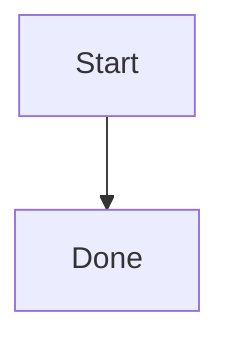

# Aero · Local-First AI Knowledge Workspace 技术方案

> 状态：草案 v0.9（2026-09-15）
> 投入假设：单人、业余时间（约每周 10 小时）。排期见第 18 节。
> 本文是后续所有架构决策的依据。产品与范围层面的决定已全部拍板，见第 22 节；剩余待定项均为由 M0 spike 数据决定的技术选型。
> UI 与交互设计见 `docs/ui_design.md`。
> 当前验收状态（2026-09-16）：M1 编辑/搜索主流程已实现，完整验收尚未关闭。保存保护修复、自动化测试、性能实测及待验项目见 [M1 验收记录](qa/m1.md)。

---

## 1. 项目定位

目标是开发一款兼具 **Notion 的编辑体验、Obsidian 的本地开放性、Zed 的性能与工程理念，以及 AI-native 检索能力** 的本地知识管理软件。

产品不以"Notion Clone"或"Obsidian Clone"为目标，而是定位为：

> **Local-First AI Knowledge Workspace / Knowledge IDE**

核心理念：

- 数据首先属于用户，而不是应用。
- Markdown/纯文本是知识的长期载体。
- Block 是编辑和索引的基本单位。
- 本地文件是 Source of Truth。
- 搜索索引、向量索引、数据库均为可重建缓存。
- AI 是知识库的另一个 Client，而不是数据存储层。
- 应用即使消失，用户的数据仍应具有完整可读性。

格式路线明确为 **扩展 Markdown**：不发明私有格式，在 CommonMark/GFM 之上分层叠加扩展语法，且每一层扩展都必须在第三方 Markdown 工具中"可降级阅读"。详见第 6 节。

Notion、Obsidian、Zed 都只是思路参考。特别地，**与 Obsidian 的兼容不是目标**：借鉴它的语法是因为这些设计本身好且可降级，需要偏离时可以偏离。

---

## 2. 核心需求

产品需要优先解决以下六个问题。

### 2.1 极致本地性能

所有正常文档浏览、编辑、搜索都不依赖网络。

目标体验：

- 启动后立即可用
- 打开文档无网络等待
- 搜索结果毫秒级返回
- 大型知识库仍保持流畅
- 编辑过程不等待数据库或云服务

架构采用：

```text
Local Files
    ↓
Local Index
    ↓
Local Application
```

云端只承担：

```text
Sync / Backup / Optional AI
```

而不是：

```text
Cloud
 ↓
Application
```

具体性能预算见第 19 节。

### 2.2 Notion 级的块编辑体验

- 以 Block 为单位组织、选择、拖拽、转换类型。
- `/` 唤出块菜单，Markdown 快捷输入（`# `、`- `、`> `、`**`）即时生效。
- 在保持 Markdown 为唯一存储格式的前提下，尽量隐藏语法噪音。
- 中文输入法（IME）是一等公民，而不是事后修补。

### 2.3 开放、可降级的扩展 Markdown 格式

- 文件用任何编辑器都能读、能改。
- 扩展语法优先借鉴社区已广泛使用的约定（Obsidian、GitHub 等），不自造轮子；但不以任何工具的兼容为约束。
- 应用只重写用户实际编辑过的部分，绝不"顺手"重排未改动的文本。

### 2.4 知识互联

- 双向链接、块引用、嵌入、标签。
- 反向链接和未解析链接实时可见。
- 图谱是索引之上的查询视图，而非独立数据。

### 2.5 AI-native 检索与接入

- 全文检索 + 语义检索，索引粒度到 Block。
- 通过 MCP 与 CLI 把知识库暴露给任意 AI 客户端；v1 不做应用内对话/摘要，AI 能力全部经由 MCP/CLI。
- Embedding 默认本地；明确哪些数据会离开本机。

### 2.6 对外部修改与同步友好

- 文件被其他工具或同步软件修改时，应用能正确感知、合并、不覆盖。
- 索引和缓存不进入 vault，不给同步工具制造噪音。
- 不绑定任何同步方案。

---

## 3. 总体技术栈

```text
Rust (edition 2024)
│
├── GPUI + gpui-component / gpui-base      UI 框架、组件、文本引擎
│   ├── Window / Rendering
│   ├── Virtual List
│   ├── Keyboard / Focus / IME
│   └── Block Editor（自研，见第 9 节）
│
├── Rope + Anchors                          文档文本模型（第 7 节；ropey 2.0 + marker 表，ADR 0004）
│
├── Markdown Parser                         comrak（默认）/ markdown-rs（备选），第 8 节
│
├── Document / Block Model                  第 7 节
│
├── SQLite (rusqlite)                       元数据、链接、标签、索引状态
│
├── 全文 + 向量索引                         zvec-rust（一套引擎，ADR 0003）
│                                           jieba 分词，dylib 随应用分发（第 10、16 节）
│
├── Embedding（Phase 3）                    fastembed（本地 ONNX，多语言模型）
│
├── 重内容渲染（第 9.9 节）
│   ├── RaTeX                               LaTeX 数学（纯 Rust KaTeX 移植）
│   ├── merman                              mermaid（headless 纯 Rust）
│   ├── hayro                               PDF 页面光栅化（纯 Rust）
│   ├── resvg                               SVG → 位图
│   └── reqwest + scraper                   链接卡片元数据抓取
│
├── notify + ignore                         文件监听、vault 扫描
│
├── GPUI Executor（主）/ Tokio（受限）      异步模型见第 15 节
│
├── MCP Server (rmcp)                       AI 接入
│
└── CLI (clap)                              脚本与 AI 的通用接口
```

### 3.1 UI 层

```text
gpui-kit（crates.io 单一依赖，自带匹配版本的 GPUI）
├── GPUI（以 gpui-pre 发布）
├── gpui-base（无样式基础层：Input / Textarea / Editor / 文本引擎）
└── gpui-component（有样式组件：列表、菜单、对话框、VirtualList 等）
+
自研 Design System
```

原则：

> 学习 Zed，复用 GPUI，但不要把产品变成 Zed Fork。

不 fork Zed 的原因有二：工程上 Zed 的 `editor` 与其 `project`/`language`/`multi_buffer` 深度耦合，剥离成本高于自研；许可上 GPUI 是 Apache-2.0，而 Zed 的 `editor` 等 crate 是 GPL/AGPL，引入会改变产品的许可边界。

GPUI 处于 pre-1.0，版本间有 breaking change。上游已把 GPUI + gpui-base + gpui-component 打包为 crates.io 上的 `gpui-kit`（M0 验证时为 0.6.1，见 ADR 0001），不再需要 git 依赖。策略：在根 `Cargo.toml` 精确锁定版本（`=x.y.z`），按季度评估升级，升级作为独立任务而非顺带完成。

### 3.2 Crate 分层

```text
aero/
├── crates/
│   ├── aero-core        vault、Knowledge Markdown 解析/序列化、Block 模型、
│   │                    链接解析、索引管线。无 UI 依赖，可 headless 测试。
│   ├── aero-index       全文 / 向量索引实现（zvec、Tantivy、SQLite；core 只依赖 trait）
│   ├── aero-app         GPUI 桌面应用
│   ├── aero-cli         `aero search / read / append / index ...`
│   └── aero-mcp         MCP Server，本质是 aero-core 的薄包装
└── docs/
```

"AI = Another Client"落到代码上，就是 GUI、CLI、MCP 三者都是 `aero-core` 的客户端，没有任何一方拥有特权路径。

---

## 4. 核心架构原则

```text
Markdown = Source of Truth

Block = Editing Unit

Index = Disposable Cache

AI = Another Client
```

由此推出的四条工程纪律：

1. **只重写被编辑的 Block。** 未改动的字节原样写回，序列化器没有"格式化整篇文档"的入口。
2. **未知语法原样保留。** 解析不了的内容成为 `Raw` block，渲染为源码，写回时逐字节一致。
3. **每个扩展语法必须可降级。** 在 GitHub / 任意 Markdown 编辑器 / 纯文本编辑器中打开，内容仍然可读、顺序不乱。
4. **索引不进 vault。** vault 内只放小体积、值得同步的配置。

---

## 5. 数据存储设计

### 5.1 Vault

一个知识库本质上就是普通文件夹：

```text
~/Knowledge/
├── daily/
│   ├── 2026-09-13.md
│   └── 2026-09-14.md
├── rust/
│   ├── ripgrep.md
│   ├── ripgrep.assets/
│   │   ├── 01k5a8.png
│   │   └── architecture.svg
│   ├── cargo.md
│   └── tokio.md
├── projects/
│   └── knowledge-app.md
└── .aero/
    ├── vault.toml
    ├── config.toml
    └── templates/
```

真正不可丢的数据是：

```text
*.md
*.assets/**
.aero/*.toml（可选，丢了只损失偏好设置）
```

### 5.2 `.aero/` 只放配置

```text
.aero/
├── vault.toml       vault_id（ULID）、格式版本
├── config.toml      附件目录、链接解析偏好、新建内容的序列化风格
└── templates/       新建笔记模板
```

其中 `vault_id` 用来把 vault 与应用数据目录里的索引关联起来。

### 5.3 索引与缓存放在应用数据目录

```text
~/Library/Application Support/Aero/           (macOS)
~/.local/share/aero/                          (Linux)
%APPDATA%\Aero\                               (Windows)
└── vaults/<vault_id>/
    ├── meta.sqlite       元数据、链接、标签、索引状态
    ├── index/            全文 + 向量索引（zvec Collection，或 Tantivy 目录）
    └── cache/            缩略图、公式/图表/PDF 页面位图、链接卡片元数据（9.9 节）
```

理由：local-first 用户几乎必然用 iCloud / Dropbox / Syncthing / git 同步 vault。高频写、体积大的索引若放在 vault 内，会被反复上传并产生冲突副本。上述目录都可以删除并从 `*.md` 重建。

同一目录下还有两个不是缓存的条目，删除它们会丢东西：`state.toml`（最近打开的 vault、面板折叠状态）和 `demo-vault/`（示例库，由库选择页的入口交付，见 UI 设计 11 节）。示例库是用户可编辑的真实笔记：新版本只更新其中没被改动过的示例，改过的内容不会被覆盖。

### 5.4 附件

- **默认每篇笔记一个附件子目录**：`<note>.md` 的附件放在同级的 `<note>.assets/`。加 `.assets` 后缀而不是直接同名，是为了与"同名笔记文件夹"（如 `rust/tokio/` 下还有笔记）区分，文件树中可以把 `*.assets/` 折叠到所属笔记之下。
- 可在 `config.toml` 改为 vault 根 `assets/` 或笔记同级目录。
- 粘贴图片：写入所属笔记的附件目录，文件名 `<ulid-short>.<ext>`，插入 `![[01k5a8.png]]`。
- 图片/附件路径解析顺序：所属笔记的 `.assets/` → 相对笔记所在目录 → vault 内唯一文件名。
- 重命名/移动笔记时一并移动其 `.assets/` 目录并更新引用；删除笔记时若附件目录非空，提示用户一并删除或保留。
- 附件目录只被建立索引（用于引用计数与孤儿附件检测），内容不进全文索引。

### 5.5 文件写入策略

- 自动保存，编辑停止 500 ms 后落盘；失焦、切换文档、退出时立即落盘。
- 原子写：写临时文件后 `rename`。保留原文件权限；因 `rename` 会改变 inode，对依赖 inode 的监听器做重新注册。
- 保留原文件的行尾风格（LF/CRLF）、BOM、末尾换行；新文件统一 LF、末尾单换行、无 BOM。
- 写入前校验磁盘上的 mtime/hash 与上次读取一致，不一致进入冲突流程（第 12 节）。

---

## 6. Knowledge Markdown 规范

### 6.1 设计原则

Knowledge Markdown 是分层的：

```text
L2  Aero 扩展层      directives、数据块         —— v1 不启用，M4 之后再评估
L1  惯用扩展层       wikilink、embed、^id、#tag、callout、==、%%、$math$
L0  基础层           CommonMark + GFM + YAML Front Matter
```

规则：

1. 下层的语义不因上层扩展而改变；上层解析失败时退回下层解释。
2. 所有行内扩展在代码块、行内代码、数学、链接 URL 内一律不生效。
3. L1 借鉴 Obsidian、GitHub 等社区已广泛使用的语法，取其设计而非追求兼容；需要偏离时在本节写明理由。只有没有现成惯例时才考虑 L2。
4. 每个扩展必须在本节写明"降级表现"。

### 6.2 L0：CommonMark + GFM + Front Matter

- CommonMark 0.31 全集。
- GFM 扩展：表格、任务列表、删除线、自动链接、脚注。
- YAML Front Matter：文件首行 `---` 开始的块。保留键：

```yaml
---
id: 01K5A8Z3QF7P9R2M4N6T8V0X1Y   # ULID，可选，按需生成（见 6.3.4）
title: ripgrep                   # 缺省取一级标题或文件名
aliases: [rg]
tags: [rust, cli]
created: 2026-09-14              # 仅在应用内新建笔记时写入一次
---
```

- `created` 只在新建时写入（可在 `config.toml` 关闭）；**不自动维护 `updated`**，避免每次保存都改动文件头、污染 diff。"最近修改"一律取文件 mtime。用户手写的 `updated` 键原样保留，不解释、不覆盖。
- 未知键原样保留。应用修改 front matter 时只改动目标键所在行，不重新序列化整块 YAML。

### 6.3 L1：惯用扩展层

以下语法借鉴自 Obsidian 等工具的社区惯例。它们在这些工具中"恰好"能原生渲染是附带收益，不是设计约束。

#### 6.3.1 Wiki Links

```text
[[target]]
[[target|显示文本]]
[[target#标题]]
[[target#^block-id]]
```

解析顺序：精确路径（含或不含 `.md`）→ 唯一文件名 → front matter `title`/`aliases` → 多个候选时视为歧义，编辑器提示消歧 → 无候选为未解析链接（渲染为可点击创建）。重命名文件时全库更新链接文本；若目标笔记有 `id`，链接索引同时记录 id，作为路径变化时的兜底解析。

降级：GitHub 显示为字面 `[[target]]`；支持 wikilink 的编辑器可原生渲染。

#### 6.3.2 Embeds

```text
![[note]]                   嵌入整篇
![[note#标题]]              嵌入章节
![[note#^block-id]]         嵌入单个块
![[01k5a8.png]]             图片（按 5.4 的顺序解析路径）
![[01k5a8.png|400]]         指定宽度
```

嵌入内容只读渲染，点击进入源文档编辑。循环嵌入检测深度上限 5。

降级：字面显示。

#### 6.3.3 Block IDs

```text
这是一个段落。 ^para-id

- 列表项
- 列表项

^list-id
```

- 段落：`^id` 置于段落最后一行末尾。
- 多行块（列表、代码块、表格、引用）：`^id` 独占一行，与块之间空一行。
- 字符集 `[A-Za-z0-9-]`，自动生成为 6 位 base32。

**持久化策略：只有被引用的块才写入 `^id`。** 用户在其他地方引用某块时，编辑器自动生成并写入；删除所有引用后 `^id` 保留（避免破坏外部工具的链接），用户可手动清理。未被引用的块不会在文件中留下任何标记。

降级：显示为末尾的 `^xxx` 字面文本。

#### 6.3.4 Note ID（front matter `id`）

- 类型 ULID。
- **按需生成**，触发条件：用户显式要求；被其他笔记以 id 引用；配置 `always_assign_id = true`。
- 打开已有 vault 时绝不批量注入 `id`。

#### 6.3.5 Tags

```text
#rust  #rust/cli  #中文标签
```

行内标签与 front matter `tags` 等价，索引合并。规则：`#` 后首字符不能是数字；允许 Unicode 字母、`-`、`_`、`/`；标题行内的 `#` 不是标签。

降级：字面文本。

#### 6.3.6 Highlight 与 Comment

```text
==高亮文本==
%%不渲染、不导出的注释%%
```

`%%` 内容进入全文索引但标记为 comment，搜索结果可选是否包含。`==` 等价于"黄色背景"（见 6.3.10），是背景色中唯一有专用语法的一种。

降级：字面文本。

#### 6.3.7 Callouts

```text
> [!note] 可选标题
> 正文
> [!warning]- 默认折叠
> [!tip]+ 默认展开
```

类型集合：note / tip / warning / danger / info / question / example / quote，未知类型按 note 渲染。折叠标记 `-`/`+` 用来承担 Notion "toggle" 的角色，因此**不另设 toggle 语法**。

降级：GitHub 把 NOTE/TIP/IMPORTANT/WARNING/CAUTION 渲染为 alert，其余显示为普通引用；纯文本可读。

#### 6.3.8 Math

```text
$E = mc^2$

$$
\int_0^1 f(x)\,dx
$$
```

- 渲染器 [RaTeX](https://github.com/erweixin/ratex)（MIT，KaTeX 的纯 Rust 移植，>99.5% KaTeX 语法覆盖，自带 KaTeX 字体约 548 KB）。
- M1 显示带高亮的源码；M2 起渲染位图；M4 改为直接消费 RaTeX 的 display list 用 GPUI 绘制，公式随主题变色、随字号缩放、行内公式按 baseline 对齐。
- **落地路径（2026-09-22 调研 `0.1.14`）**：RaTeX 在 crates.io 上按职责拆成多个 crate（`ratex` 本体是占位包，不要依赖它）。四步串起来：
  ```rust
  let ast = ratex_parser::parse(latex)?;                       // LaTeX → AST
  let lbox = ratex_layout::layout(&ast, &LayoutOptions::default()
      .with_style(style)          // 行间 $$ / 行内 $
      .with_color(color));        // 排版阶段就能给颜色
  let list = ratex_layout::to_display_list(&lbox);
  let png = ratex_render::render_to_png(&list, &RenderOptions {
      font_size, padding, background_color: 透明, device_pixel_ratio: 窗口倍率, font_dir: 空
  })?;
  ```
  颜色在 `layout` 阶段设定，所以公式直接按主题前景色排版，**不需要** 9.9 里"单色 SVG + alpha 蒙版着色"那条绕路；相应地缓存键要带上主题色。字体用 `ratex-render` 的 `embed-fonts` 特性内嵌 KaTeX TTF，运行时不依赖 `font_dir`，打进 `.app` 即可用。`ratex-svg`（→ resvg 光栅化）与 `ratex-pdf` 暂不需要，留给导出。
  渲染服务（9.9）的请求"源"因此要从"vault 内文件"泛化成"文件 | 公式源码"：图片按文件内容指纹入盘，公式按源码 + 字号 + 颜色指纹入盘。
- 渲染失败或语法不支持时显示源码 + 错误提示，内容不丢。
- 备选 `typst` + `mitex`（质量更高但二进制多 5–10 MB），仅在 RaTeX 停滞时启用。ReX 上游已停更，不考虑。

降级：GitHub 原生渲染 `$$` 数学；纯文本可读。

#### 6.3.9 图表、PDF 与链接卡片

这三类内容都不引入新语法，全部复用 L0/L1 已有形式，靠渲染层识别。

**mermaid**

````text

````

- 渲染器 [merman](https://github.com/Latias94/merman)（MIT/Apache-2.0，headless 纯 Rust，对齐 mermaid@11.15，不启动浏览器或 JS 运行时）。使用其 `render_svg_resvg_safe_sync()` 管线（去掉 `<foreignObject>`），SVG 经 resvg 转位图。
- 接入 merman 的宿主文本测量回调，用 GPUI 文本系统测量标签宽度，保证中文标签不被裁切。图内 `$$` 数学标签 merman 默认调用 RaTeX，与 6.3.8 一致。
- 不支持的图类型或语法错误：按普通代码块显示源码 + 错误提示。
- 备选 `mermaid-rs-renderer`（更快，覆盖窄）。

降级：GitHub 原生渲染 mermaid 代码块；其他工具显示为代码块。

**PDF 嵌入**

```text
![[paper.pdf]]
![[paper.pdf#page=3]]
```

- 渲染器 [hayro](https://github.com/LaurenzV/hayro)（纯 Rust，`forbid(unsafe_code)`，回归集 1000+ PDF）。已知限制：不支持加密 PDF、部分混合模式，性能尚未优化，复杂页面可能秒级——因此一律后台渲染并缓存页面位图。
- 形态：嵌入块显示指定页（默认首页）的位图与页码翻页，双击用系统阅读器打开。不做 PDF 编辑、批注、正文搜索（正文进全文索引为 M4 之后的独立事项）。
- 排除 MuPDF（AGPL）与 poppler（GPL）；`pdfium-render` 需分发动态库，仅在 hayro 性能不可接受时作为回退。

降级：显示为字面 `![[paper.pdf]]`，文件本身仍在 `.assets/` 中。

**链接卡片**

```text
https://example.com/article        独占一行的裸 URL → 渲染为链接卡片
[标题](https://example.com)         行内链接 → 普通链接，悬停显示卡片
```

- 网页相关能力**只做链接卡片**：抓取目标页的 title / description / OpenGraph 图片 / favicon，原生渲染为卡片块。不做网页剪藏，不做内联或侧栏的实时网页视图（gpui-wry 为实验性、只支持 macOS/Windows、且永远覆盖在 GPUI 元素之上）。
- 抓取走 `reqwest` + `scraper`，运行在第 15 节的 Tokio 边界内；元数据按 URL 缓存在 `cache/`，默认 7 天过期；离线或失败时显示纯链接。
- 隐私：抓取会向目标站点发出请求，属于"内容离开本机"的一种，在设置中可整体关闭（默认开启，因为只发送 URL 本身而非笔记内容）。

降级：就是普通 URL / 链接，任何工具可读可点。

#### 6.3.10 属性列表与颜色

Markdown 没有颜色语法。借鉴 Pandoc 与 markdown-it-attrs 共有的**属性列表** `{.class key=value}` 约定，用它承载 Notion 式的文字颜色与块颜色，同时给将来其他块/行内属性留出位置。

```text
[文本]{.red}                      行内文字颜色
[文本]{.bg-blue}                  行内背景色
[文本]{.red .bg-yellow}           两者叠加
**粗体**{.blue}                   属性可紧跟任何行内元素（强调、代码、链接、==高亮==）
==文本==                          黄色背景的专用写法，等价于 [文本]{.bg-yellow}

这是一个段落。 {.bg-blue}          块颜色：属性列表置于块末，前有空格
这是一个段落。 {.red} ^para-id     与 ^id 共存时属性在前、id 在后
# 标题 {.red}                     标题（与 Pandoc header attributes 完全一致）
- 列表项 {.green}                 单个列表项

- 列表项
- 列表项

{.bg-gray}                        多行块：独占一行，与块之间空一行，规则同 ^id
```

- **调色板**（与 Notion 对齐，9 色）：`gray brown orange yellow green blue purple pink red`；文字色直接用类名，背景色加 `bg-` 前缀。具体色值由主题定义，浅色/深色各一套。
- 解析分工：标题、代码段、链接/图片、围栏代码后的 `{...}` 由 comrak 原生解析（ADR 0002）；`[文本]{...}` 与块末属性由 aero-core 后处理。
- **块颜色**作用于整个块及其子块（列表项含子列表、callout 含正文）。
- 未知的类名与 `key=value` 原样保留、不渲染、不丢失；`{}` 内容不进全文索引。
- 识别规则：行内属性列表必须紧跟行内元素或 `[文本]` 结束的 `]`，中间无空格；块属性列表必须位于块末且前有空格，或按 `^id` 的独占行规则。其他位置的 `{...}` 都是普通文本。`\{` 取消含义。
- **写回规则**：用户选"黄色背景"时写 `==文本==`（兼容性最好）；其他颜色写属性列表。选区恰好覆盖一个已有行内元素时，把 `{}` 挂在该元素之后而不是再包一层 `[ ]`。去掉全部颜色后删除 `{}`，若 `[ ]` 不再承载任何属性也一并去掉。
- 被否决的写法：内联 HTML `<span style="color:...">`（GitHub 会过滤 `style`，源码噪音大，且本方案对 HTML 只做透传不渲染）；自造 `=={red}文本==`（没有任何工具认识）。

降级：GitHub 与纯文本显示为字面 `{.red}`、`[文本]{.red}`，噪音水平与 `^id` 同级；Pandoc 与 markdown-it-attrs 系工具（VitePress 等）识别为 class，可通过 CSS 上色。

### 6.4 L2：Aero 扩展层

**L2 整体不进入 v1**（M4 之后再评估），本节只是预留语法空间，保证 v1 的解析器为这些形式留出 `Raw` 透传路径，避免将来引入时破坏往返。新增任何 L2 语法必须先回答：为什么 L1 不够、如何降级。

#### 6.4.1 容器 Directive

采用 CommonMark generic directives 提案的语法：

```text
:::name {key=value another="v"}
任意 Markdown 内容，可嵌套
:::
```

- 名称 `[a-z][a-z0-9-]*`，属性为 `{}` 内的 `key=value` 列表。
- 围栏至少 3 个冒号，闭合围栏的冒号数必须与开启围栏一致；嵌套时外层使用更多冒号（如 `::::columns` 内嵌 `:::column`），与代码围栏的规则相同，避免闭合歧义。
- 未知 name：内容按普通 Markdown 渲染，`:::` 行作为不可见的 `Raw` 边界保留。v1 中所有 directive 都按此处理。
- 首个候选容器：`::::columns` / `:::column`（多列布局），M4 后评估。

降级：`:::` 行显示为字面文本，内容顺序、可读性不受影响。

#### 6.4.2 行内 Directive

```text
:name[显示文本]{key=value}
```

预留，v1 不解析，按普通文本处理。

#### 6.4.3 数据块

以特定 info string 的代码围栏承载结构化内容，例如：

````text
```query
tag: #rust
sort: updated desc
```
````

- 数据块内部不是 Markdown，由对应处理器解释；v1 中一律作为普通代码块渲染。
- 首个候选 `query`（按标签/目录/属性列出笔记），M4 后评估。

降级：显示为代码块，内容可读。Obsidian Dataview / Bases 采用同样的做法。

### 6.5 转义与冲突

- `\[[`、`\#`、`\==`、`\%%`、`\:::`、`\{` 取消扩展含义。
- 代码块、行内代码、数学内不解析任何 L1/L2 语法。
- 段落末尾的 `^id` 只在紧贴行尾且前有空格时成立；`a^b` 不是 block id。
- 属性列表 `{...}` 只在 6.3.10 规定的位置成立，且内部必须全部是 `.class`、`#id` 或 `key=value` 形式的 token；`f(x) = {1, 2}` 之类留在原地不动。`[文本]{...}` 优先于 GFM 的链接引用（`[文本]` 无对应定义时 CommonMark 本来就按字面处理，因此不冲突）。
- Callout 标记 `[!type]` 只在引用块首行首个 token 位置成立。
- 与 GFM 冲突处：`[[x]]` 优先于链接引用定义 `[x]`；`==` 仅在成对且不跨行时成立。

### 6.6 降级总览

- **纯文本编辑器**：一切可读；扩展语法以字面形式出现，顺序不变。
- **GitHub**：L0 全部正确；callout 部分渲染为 alert；wikilink/embed/tag/`^id`/`{.color}`/`:::` 显示字面文本。
- **支持 wikilink 的 Markdown 编辑器（如 Obsidian）**：L1 大部分能原生渲染，这是附带收益而非承诺。

### 6.7 示例

````markdown
---
id: 01K5A8Z3QF7P9R2M4N6T8V0X1Y
title: ripgrep
created: 2026-09-14
tags:
  - rust
  - cli
---

# ripgrep

安装：

```bash
brew install ripgrep
```

升级：

```bash
brew upgrade ripgrep
```

^upgrade-command

> [!tip]- 常用参数
> `-t rust` 按类型过滤，`-g '!target'` 排除目录。

相关内容：[[Rust CLI]]，另见 #rust/cli

架构图（位于 `ripgrep.assets/architecture.svg`）：

![[architecture.svg]]

嵌入另外一篇文档：

![[Rust Search]]
````

---

## 7. 文档与 Block 模型

### 7.1 Block 的定义

Block 与 CommonMark 的块级节点一一对应，分两类：

- **Leaf Block（编辑单位）**：Paragraph、Heading、CodeFence（围栏；DataBlock 6.4.3 只是特定 info 的 CodeFence）、CodeBlock（缩进）、MathBlock、Table、ThematicBreak、HtmlBlock、FrontMatter、Raw、Marker（独占行的 `^id` / 属性列表，见 7.2）。
- **Container Block（结构单位）**：List、ListItem（每个列表项是一个 block，与 Notion 一致；List 本身只是容器）、BlockQuote / Callout、FootnoteDefinition、Directive。

编辑器的光标永远位于某个 Leaf Block 内；拖拽、多选、缩进操作作用于 Leaf 或 ListItem。

### 7.2 数据结构

```rust
struct Document {
    path: VaultPath,
    text: Rope,                    // 唯一文本真相
    front_matter: Option<Range<Anchor>>,
    blocks: BlockTree,             // 只持有 range，不复制文本
    version: u64,
}

struct Block {
    id: BlockId,                   // 会话内稳定的内部 id
    kind: BlockKind,               // callout 类型 / 折叠、directive 名、围栏 info、任务勾选等都在 kind 的参数里
    range: Range<Anchor>,          // 随编辑自动漂移的锚点，覆盖块的全部源文本
    suffix_len: u32,               // 尾部 ` {.red} ^id` 标记占的字节数，编辑器显示正文时去掉
    persisted_id: Option<Arc<str>>,// 文件中的 ^id（如有）
    attrs: Attrs,                  // 属性列表（颜色等）
    hash: u64,                     // 块源文本的 xxh3，供 7.3 身份匹配与索引增量
    children: Vec<Block>,
}
```

独占一行的 `^id` / `{属性列表}` 在树里是一个 `Marker` 块：区间照实覆盖那一行（往返、间隙校验都不用特判），语义（id、属性）已挂到前一个兄弟块上，UI 不渲染它。

Inline 树节点同样带 `attrs`，承载 6.3.10 的行内属性列表。

选择"一份 Rope + Block 树持有 range"而不是"每个 Block 一个 buffer"，原因：跨块选区、统一 undo 栈、按字节偏移写回都更直接。

**已定（ADR 0004）**：`Rope` = `ropey =2.0.0-beta.1`，与 gpui-base 内部同版本、同 feature（`metric_chars` / `metric_lines_lf` / `metric_utf16`），随 gpui-kit 一起升级。ropey 2.0 是字节索引 API，与 comrak 的源位置、gpui-base 的光标 / 选区偏移三方一致；10 MB 文档上编辑 0.4 µs、`clone()` 快照 0.02 µs、行 / char 换算 0.05–0.2 µs、物化整篇 0.7 ms、堆开销 11%。

`Anchor` 不是 rope 的功能，由 `aero-core` 自己实现：一张按位置排序的 marker 表，块区间 = `(start, Bias::Left)` + `(end, Bias::Right)`（块首、块尾的输入都归入该块）。每次编辑二分定位后线性平移，10 MB（19 万 marker）上 49 µs；每次重解析后整表重建。选区、光标、IME 标记区间同样用 marker 表达。spike 回放 1 万次随机编辑后 8.5 万个未触碰块的文本全部与原文一致。

### 7.3 Block 身份

- 内部 `BlockId` 在会话内稳定，供 UI 状态（折叠、选中）与索引增量更新使用。
- 重新解析后沿用旧 id 的匹配分四级（`aero-core::document`，随机编辑序列的属性测试保证：未被触碰、仍在原位的块 id 不变，且撤销后仍不变）：
  1. `(kind, 内容 hash)` 相同且起点重合——旧块的起点取已漂移的 anchor，与新区间同一坐标系；
  2. `(kind, 内容 hash)` 相同、起点最近——同内容的"孪生块"必须先做第 1 级，否则一个被改动后其余会在先序贪心里被错位认领；
  3. 同 kind、起点最近——内容被改过的块；
  4. 不限 kind、起点相差 ≤ 2 字节——段落 ↔ 标题 ↔ 列表项这类改前缀的类型转换保住身份，`/` 菜单切换块类型不丢焦点与折叠状态。
  其余分配新 id。
- 持久化身份只有 `^id` 与 front matter `id`，规则见 6.3.3 / 6.3.4。未被引用的块身份允许漂移。

### 7.4 编辑管线

```text
键入 / 块操作
  → [同步段，按键路径] Rope 编辑（记录到 undo 栈）→ marker 表平移 → 聚焦块从 Rope 切片重绘
  → [异步段] Rope.clone() 快照 → 后台线程物化 + 重解析（第 8 节）
       → 主线程 Block 树 diff → 重建 marker 表、BlockId 映射（7.3）→ 视图增量刷新（只重建受影响的块元素）
  → 500 ms debounce → 原子写盘（第 5.5 节）
  → 文件事件被自身写入过滤 → 索引增量更新（第 10 节）
```

同步段在 10 MB 文档上 < 0.2 ms。异步段的解析成本随文档线性（真实笔记约 18 ms/MB，见 ADR 0002）：文档 < 256 KB 时允许直接在同步段里解析（≤ 5 ms），超过则一律走后台；期间视图靠漂移后的 anchor 保持一致，解析结果回来后再 diff。

---

## 8. 解析与无损往返

### 8.1 解析策略：整篇重解析 + 树 diff

不做增量解析。笔记文件通常在数 KB 到数百 KB，成熟解析器整篇解析耗时在 1 ms 量级；超过 2 MB 的文件将解析移到后台并在完成前冻结块结构（仍可编辑当前块）。解析结果与旧 Block 树做 diff（7.3），保证 UI 状态和索引增量都基于稳定的 BlockId。

这一策略比 tree-sitter 增量解析实现简单得多，且不需要为每个扩展语法修改 grammar。

### 8.2 解析器选型

要求：带准确源位置（block 与 inline 级）、支持 front matter / 表格 / 脚注 / 数学 / wikilink，可插入自定义 inline 语法。

**已定：comrak**（ADR 0002，2026-09-15）。M0 spike 用 CommonMark spec 655 用例 + 45 篇真实笔记 + 合成 1 MiB 文档对比了 comrak 0.55 与 markdown-rs 1.0：

- 速度：comrak 快 10–60 倍；markdown-rs 在 1 MiB 上超线性（1.13 s），无法支撑整篇重解析。
- 覆盖：comrak 原生支持 wikilink、`==高亮==`、`[!note]` callout、`:::` 块级容器（按冒号数嵌套）、标题/代码段/链接的 `{.class}` 属性、CJK 友好强调；markdown-rs 均无。
- 位置：两者节点 100% 带位置。comrak 有两个具体缺陷——缩进的表格行内单元格位置左移、链接引用定义之后的同段文本错位；另外 `FootnoteDefinition` 被移到 AST 末尾、链接引用定义无节点、`$$` 块公式是段落内的 display Math。全部在后处理层补偿。

```text
原文
 → comrak（front matter / strikethrough / table / tasklist / footnotes / math / wikilinks /
           highlight / block_directive / attributes / cjk_friendly_emphasis；alerts 关闭）
 → 转换：sourcepos → 字节区间；越出父区间 / 非 char 边界的夹回并计入报告
 → 后处理（aero-core::parse）：
      兄弟块按区间排序（FootnoteDefinition 归位）→ 兄弟重叠时截断前者（块起点比终点可靠）
      → 仅含 display Math 的段落 → MathBlock
      → 段尾 / 独占行的 ^id 与 {属性列表}（独占行成为 Marker，语义挂到前一个兄弟）
      → 引用块首行 [!type]± 标题 → Callout（Aero 的 8 种类型与 GitHub 的 5 种走同一条路）
      → 顶层块之间含非空白内容的间隙 → Raw（链接引用定义等 comrak 不产节点的内容）
 → Block 树（带字节区间）；Inline 树（embed / #tag / %% / [文本]{属性} / 行内 directive）为 M1a 事项
```

后处理带一份 `ParseReport`（夹回 / 丢弃 / 补 Raw 的计数与明细）。CommonMark spec 655 例、样本文件与合成文档上要求块级零夹回；真实笔记里目前只见过"列表项内段落末尾多算一个空格"这一种 1 字节夹回。

### 8.3 无损往返规则

1. 未修改的 Block 写回时逐字节等于原文（包括缩进、空行数、转义方式、软换行）。
2. 修改一个 Block 只重新序列化该 Block 的区间；块的分裂/合并只影响相邻区间。
3. `Raw`/`HtmlBlock` 永远逐字节透传。
4. 属性测试：对语料中每个文件，`serialize(parse(x)) == x`；对随机编辑序列，未触及区间保持不变。
5. 解析器版本升级必须通过全部往返测试后才能合入。

### 8.4 序列化风格只作用于新内容

`config.toml` 里的风格配置（bullet 用 `-`、强调用 `**`/`*`、缩进 2 空格、表格是否对齐等）只影响编辑器新生成的文本，绝不用于重排已有内容。

---

## 9. Block Editor

### 9.1 形态：块级 Live Preview，渐进走向 WYSIWYG

- **未聚焦块**：完全渲染（标题样式、加粗、链接、图片、callout 外框）。
- **聚焦块**：显示该块的 Markdown 源码，并同时应用样式（`**粗体**` 显示为粗体且保留星号，即 Live Preview 在块粒度上的行为）。
- **Phase 2**：在聚焦块内隐藏成对的语法标记（`**`、`==`、`[[ ]]`），光标接近时显现，达到接近 Notion 的观感。

选择这条路线的原因：源码即真相，往返无损成为必然而不是需要证明的性质；Phase 1 可以借助现成的文本引擎快速得到正确的 IME、选区、换行行为；WYSIWYG 只是在同一模型上叠加"标记隐藏"，可以渐进推进。

### 9.2 渲染结构

- 文档是一个 GPUI 虚拟列表（gpui-component `VirtualList` 或 GPUI `list`），每个顶层 Block 一个元素，高度按需测量并缓存。
- 容器块递归渲染子块；列表缩进、引用竖线、callout 外框由容器元素绘制。
- 图片、嵌入、公式、图表、PDF 页面、链接卡片均经 9.9 的渲染服务异步产出，占位高度避免抖动。

### 9.3 聚焦块编辑器

Phase 1 直接使用 gpui-base 的文本引擎（`InputBaseState` 系列，含 IME、选区、软换行、`InputHighlighter` 高亮钩子）作为聚焦块的编辑控件：

- 聚焦块的编辑控件是 `Document.text` 中该块区间的一个视图；每次输入即时写回 Rope，再触发 7.4 的管线。gpui-base 的 `InputBaseState.text` 与 `Document.text` 是同一个 `ropey 2.0` 类型，光标 / 选区都是字节偏移，块文本以 `RopeSlice` 传递，不做 `String` 往返（ADR 0004）。
- 块切换时销毁/重建控件，光标位置按字节偏移直接换算，无需 char 索引转换。
- 通过 `InputHighlighter` 实现 Knowledge Markdown 的语法高亮与样式叠加。

以 trait 隔离该控件，Phase 2 若需要更细的控制（标记隐藏、inline 元素如图片/复选框），可替换为自研元素而不影响模型层。

### 9.4 选区与键盘模型

- 块内：字符级选区。
- 跨块：升级为**块级选区**（选中整块），与 Notion 行为一致。字符级跨块选区列为 Phase 2。
- `Enter` 在段落末尾新建段落；`Shift+Enter` 软换行；空列表项上 `Enter` 退出列表；`Tab`/`Shift+Tab` 调整列表层级；`Backspace` 在块首合并到上一块。
- 上下箭头跨块移动时保持视觉列位置。
- 完整的交互状态机、快捷键总表与界面布局见 `docs/ui_design.md`。

### 9.5 Undo / Redo

单一 undo 栈，记录 Rope 编辑操作。所有块操作（拖拽、转换类型、缩进）都表达为文本编辑，因此天然可撤销。相邻 300 ms 内的字符输入合并为一组；IME 组合期间不产生 undo 记录。

### 9.6 IME

- 中文、日文输入在 macOS 上是 M1 的验收项，包括：组合中下划线、候选框位置跟随光标、组合期间按 Esc/方向键、组合文本跨语法边界（例如在 `**` 内输入）。
- 在 Linux（fcitx5 / ibus）与 Windows 上分别在 M4 验收。

### 9.7 块操作

- `/` 菜单：切换块类型、插入 callout / 代码块 / 表格 / 分割线 / 嵌入 / 日期。
- 拖拽手柄：块级拖动重排，跨列表层级时调整缩进。
- 类型转换：段落 ↔ 标题 ↔ 列表 ↔ 引用 ↔ callout，均为对源文本前缀的编辑。
- 块引用：`[[note#^` 触发块选择器，自动写入 `^id`。

### 9.8 v1 不做

表格的可视化编辑（v1 编辑表格源码）、字符级跨块选区、协作光标、语法标记隐藏（Phase 2）。

### 9.9 重内容渲染服务

数学、mermaid、PDF 页面、链接卡片、大图缩略图都不在 UI 线程直接渲染，而是走同一条服务：

```text
RenderRequest { kind, source_hash, scale, theme, size_hint }
  → 内存缓存命中？→ 直接返回
  → 磁盘缓存 cache/<kind>/<hash>-<scale>-<theme>.png 命中？→ 解码返回
  → 后台线程渲染（RaTeX / merman / hayro / 链接卡片抓取）
  → 写入两级缓存 → 通知块元素重绘
```

- 块元素首帧按"上次已知尺寸"占位（尺寸也进缓存），渲染完成后替换，列表不抖动。
- SVG 结果分两类处理：单色内容（数学公式）用 GPUI `svg()` 元素以 alpha 蒙版着色，自动跟随主题色；彩色内容（mermaid、图片）经 resvg 光栅化为 RGBA 后用 `img()` 元素显示。
  数学按 6.5 的调研结论改为在 RaTeX 排版阶段直接给定主题色再光栅化，省掉 SVG 与蒙版这一跳；缓存键因此包含主题色。
- 缓存键包含主题（浅/深）与缩放倍率（HiDPI），主题切换只触发重渲染而不阻塞 UI。
- 渲染任务归第 15 节的"结构性"优先级，滚动到视口附近才排队，滚出视口即取消（hayro 的协作式取消落地后接入）。
- 渲染失败统一表现：显示源码 + 一行错误提示，可点击重试。内容永不丢失，也不写回文件。
- 所有渲染器藏在各自的 trait 后面（`MathRenderer` / `DiagramRenderer` / `PdfRenderer` / `LinkPreviewFetcher`），依赖都是 0.x 版本，随时可换。

---

## 10. 索引管线

### 10.1 总览

```text
文件事件 / 编辑保存
  → 解析（复用 aero-core）
  → 元数据 & 链接 & 标签 → SQLite（同事务）
  → 全文 → FullTextIndex（批量提交；引擎见 10.3）
  → 向量 → 后台低优先级队列 → VectorIndex（Phase 3，默认 zvec）
```

- 索引粒度到 Block：搜索结果可以直接定位到块。
- 每个文件在 SQLite 记录 `(mtime, size, hash)`，启动时只重索引发生变化的文件。
- 任何索引可以删除后全量重建；重建在后台进行，UI 显示进度。

### 10.2 元数据库（SQLite）

```sql
notes  (note_id, path, title, front_id, mtime, size, hash, created, updated, fm_json)
blocks (note_id, block_ord, kind, byte_start, byte_end, hash, persisted_id)
links  (src_note, src_block_ord, raw_target, kind, dst_note, dst_anchor, resolved)
tags   (note_id, block_ord, tag)
assets (path, referenced_by_count)
index_state (name, version, last_built)
```

`links.resolved = 0` 的记录即"未解析链接"，用于反链面板和新建笔记建议。

### 10.3 全文检索

无论引擎为何，索引文档 = Block，字段：`note_id`、`block_ord`、`title`、`body`、`tags`、`path`。`aero-core` 只依赖 `FullTextIndex` trait，引擎实现在 `aero-index` 内可替换。

**引擎：zvec FTS（已定，ADR 0003）**。随 zvec-rust 一并获得（见 10.4）：原生 BM25、短语、布尔 `+term -term "phrase"`，tokenizer 用 `jieba`（`cut_mode=search`）+ `lowercase` filter。全文与向量是一个引擎，混合检索由引擎层完成。无 snippet API，高亮在客户端基于 block 源文本自行完成。

M0 实测（`bench-10k`，120k block，Apple M5 Pro）：查询 p95 ≤ 3 ms；保存一篇（≈12 block）后 2 ms 内可搜到，不需要 `flush()`；冷打开 100 ms。Tantivy 与 SQLite FTS5 不再评估，`FullTextIndex` trait 只作为架构隔离保留。

引擎使用约束（全部来自 spike 实测）：

- **保存路径 = `upsert(新 block)` + `delete(旧有而新无的 pk)`**。旧 pk 列表来自 SQLite 的 block 表。**禁用 `delete_by_filter`**：它会留下僵尸主键——doc 查不到了，但同一 pk `insert` 报 `AlreadyExists`、`delete` 报 `NotFound`，`flush` / `optimize` 都救不回，只有 `upsert` 能覆盖。
- **正在编辑的文档**：写入即可见，所以不做内存 overlay；编辑中的 block 以 300 ms 节流 `upsert` 进引擎即可（原方案的"简单倒排 overlay"取消）。
- 刷盘与整理：保存后不 flush；空闲 30 s 无编辑时 `flush()`；后台全量重建**每 1 万 block `flush()` 一次**（否则峰值内存冲到 900 MB，分批后 ≈ 280 MB）；碎片段会让 p95 从 3 ms 涨到 9 ms，每日或段数超阈值时 `optimize()`（10k 上 0.5 s）。
- **jieba 词典裁剪（已实现）**：全词典（349k 词）常驻 ≈150 MB，是索引侧最大的内存项。`scripts/trim-jieba-dict.sh` 按词频截到 ~100k 词（磁盘 1.4 MB），长尾交给 HMM 与 search 模式的子词切分。实测常驻并非线性下降——cppjieba 的 `DictTrie` 节点开销高，100k 词裁剪后仍 ≈110 MB（省 ≈60 MB；裁到 50k 省 ≈85 MB），原先"裁后 45 MB / 省 150 MB"的估计过于乐观。领域词：zvec 的 `JiebaTokenizer` 只加载 `jieba.dict.utf8` + `hmm_model.utf8`，**不读**单独的 `user.dict.utf8`，故 `assets/jieba/user.dict.utf8` 里的领域词由脚本直接并进主词典。裁剪词典由 `fetch-zvec.sh` 产出到 `vendor/zvec/lib/data/jieba_dict_trimmed`（不入库，随 fetch 重生）；运行时 `aero-index` 显式 `set_default_jieba_dict_dir` 覆盖 zvec 自动发现的全词典，打包时装进 `Resources/jieba_dict`。
- `ngram` tokenizer 不作备选：构建慢 2 倍、磁盘 2.5 倍，英文按字母二元组匹配 precision 太差。

### 10.4 语义索引（Phase 3）

- 分块单位就是 Block（短块与相邻块合并到 ~200 token）。
- **向量存储 = [zvec-rust](https://github.com/zvec-ai/zvec-rust)**（Alibaba zvec 嵌入式向量库的 Rust 绑定，Apache-2.0；ADR 0003）：HNSW / HNSW+量化 / IVF / RaBitQ，支持 fp16、int8、binary 向量；标量字段 + 倒排 + `filter("note_id = ... AND tag = ...")`；`MultiQuery` 在引擎层完成向量路 + FTS 路的 RRF / 加权重排。每个 vault 一个 Collection，存放在 5.3 的应用数据目录。M0 实测 20k × 384 维 HNSW：写入 2.5 s，查询 p95 1.7 ms，混合 RRF p95 1.7 ms，单 doc upsert 后 2 ms 可查。
- ~~备选 `usearch` + `sqlite-vec`~~ 不再评估（zvec 四项验收全部通过）。
- Embedding 不在 zvec 范围内，仍由应用负责。默认本地 `fastembed-rs`（ONNX Runtime）：质量档选多语言模型（bge-m3 或 multilingual-e5-small）；快速档评估 model2vec 静态向量模型（如 potion 系列的 multilingual 版本，CPU 上比 transformer 快一到两个数量级，中文效果需单独验证）。首次使用时下载并提示体积。
- 可选远程 Embedding API，必须在设置中显式开启，并显示"内容将发送至 X"。
- 全量索引在后台以最低优先级运行，可暂停。混合检索直接用 `MultiQuery` RRF。
- zvec 是进程级全局状态（`initialize()` / `shutdown()` 一次，自带线程池），API 同步，全部调用放在后台线程。注意 `memory_limit` / `enable_mmap` / `max_buffer_size` 对 FTS 的常驻内存都没有作用（M0 实测），内存靠 10.3 的词典裁剪与分批 flush 控制。

### 10.5 一致性

- SQLite 是索引状态的权威；全文/向量索引若与 SQLite 的 `hash` 不一致，以文件为准重建对应块。
- 索引格式带版本号，升级时按需重建。

### 10.6 与第三方索引工具的关系

vault 就是 Markdown 文件，用户可以同时用 [zvec-grep](https://github.com/zvec-ai/zvec-grep)（`zg`，Node.js CLI + MCP，同样基于 zvec）等第三方工具对 vault 建索引并接给自己的 agent，这是"AI = Another Client"的自然结果。Aero 不复用 zg 作为组件（Node 运行时、索引落在项目根目录都与本方案冲突），但借鉴其检索管线设计：prose 按 section/chunk 分块并保留源位置、"语义发现 → BM25 锚定 → 精确文本验证"三段式、MCP 工具签名（`query` + `fts[]` + `fuse`）。Aero 自己的 MCP 提供 zg 给不了的能力：Block 级结构、链接/反链/标签、带审阅的写入。

---

## 11. 链接、反链与图谱

- 链接解析规则见 6.3.1，由 `aero-core::links` 统一实现，GUI/CLI/MCP 共用。
- 反链面板：按 `links.dst_note` 查询，显示来源块的渲染片段。
- 未解析链接：聚合展示，一键创建目标笔记（放入默认目录或链接所在目录，可配）。
- 重命名/移动：在同一事务内更新所有 `links.raw_target` 对应的文本（只改链接字符串，不触碰其他字节），并写回相关文件。
- 图谱：`links` 表的可视化，M4 提供局部图（当前笔记 2 跳），全局图列入更远的路线。

---

## 12. 文件监听与外部修改

- `notify` 监听 vault；初次扫描使用 `ignore` crate（支持 `.gitignore` 与 `.aero/ignore`）。
- 事件 debounce 200 ms；忽略 `.aero/`、附件目录以外的非 `.md` 文件，以及自身刚写入的路径（按 `(path, hash)` 在 2 s 窗口内过滤）。
- macOS FSEvents 会合并事件、其他编辑器的原子保存会产生 `Remove + Create`，统一按"路径最终状态"处理，不依赖事件类型。
- 磁盘文件变化且当前文档**无未保存修改**：静默重载，光标按块 hash 匹配复位。
- 磁盘文件变化且**有未保存修改**：以上次读取的内容为 base 做三方合并；无冲突自动合并，有冲突则保留双方版本，以 `<name>.conflict-<time>.md` 保存磁盘版本并提示。绝不静默覆盖外部修改。
- 文件被外部删除：文档转为"已删除"状态，保留内容，用户可另存。

---

## 13. AI 接入：CLI 与 MCP

### 13.1 CLI

```text
aero search "<query>" [--tag] [--limit]        全文检索，输出块级结果
aero read <note|id> [--block ^id]
aero backlinks <note>
aero append <note> --text "..."
aero new <path> [--template]
aero index rebuild | status
aero export <note> --format md|html|json
```

CLI 输出支持 `--json`。它既是脚本接口，也是 MCP 的功能基线：MCP 工具与 CLI 子命令一一对应，都调用 `aero-core`。

### 13.2 MCP Server

- 实现基于 `rmcp`，传输先支持 stdio（Claude Desktop / Cursor 等本地客户端），Streamable HTTP 列入 Phase 3。
- 工具：`search_notes`、`semantic_search`（Phase 3）、`read_note`、`read_block`、`list_notes`、`get_backlinks`、`get_tags`、`create_note`、`append_to_note`、`replace_block`。
- 资源：`aero://note/<id>`、`aero://block/<note>/<id>`。
- **写权限模型**：默认"审阅模式"，AI 的写入以待确认变更出现在应用内（diff 视图），用户确认后落盘；可对单个客户端授予直接写入权限。写入同样只重写目标块。
- 隐私：MCP Server 只监听本机；应用设置页明确列出所有会把内容发往本机以外的功能（远程 Embedding、远程 LLM），默认全部关闭。
- **v1 不做应用内 AI**（对话、摘要、改写等）。用户在自己选择的 AI 客户端（Claude Desktop、Cursor、Codex 等）里通过 MCP 使用知识库，Aero 只负责把知识库暴露得足够好。若日后加入应用内 AI，须复用同一套 `aero-core` API，并通过 OpenAI 兼容接口优先对接本地模型（Ollama / llama.cpp）。

---

## 14. 同步

- **v1 不实现同步引擎，做到 sync-agnostic**：vault 交给 iCloud / Dropbox / Syncthing / git 等工具，应用负责第 12 节的外部修改处理，这是 local-first 与"Markdown = Source of Truth"下最一致的方案。
- 内建 git 支持（自动提交、历史查看）作为 M4 候选，它与文件真相天然兼容。
- CRDT（Loro / Automerge）方案的前提是并发编辑期间以 CRDT 状态为真相、Markdown 为投影，这与第一条原则冲突。只有在明确需要实时协作时才重新评估，并且要求 CRDT 层完全可从 Markdown 重建。

---

## 15. 并发与异步模型

- 主执行器是 GPUI 的 `ForegroundExecutor` / `BackgroundExecutor`；`aero-core` 的异步接口不绑定运行时（返回 `Future`，内部用 `async-channel` / `futures` 原语）。
- Tokio 只存在于 `aero-mcp`（`rmcp` 依赖）与远程 HTTP 调用（链接卡片抓取、可选的远程 Embedding）中，运行在独立线程的 runtime 上，与 GPUI 侧通过 channel 通信。GUI 代码不得直接依赖 Tokio。
- 后台任务分三级优先级：用户可感知（解析、保存、FTS 增量）> 结构性（反链、缩略图）> 可延后（向量索引、全量重建）。低优先级任务在用户输入期间让出。
- 所有磁盘 IO 在后台线程；主线程只做布局与绘制。

---

## 16. 平台与分发

- **macOS 首发，最低 macOS 15**（与 gpui-component 的要求一致，只跟最新两代）；Linux（Wayland/X11）与 Windows 列入 M4，单人投入下视 M1–M3 的实际进度决定是否推进。
- **无移动端**：GPUI 不支持 iOS/Android。策略是坦白告知：vault 就是 Markdown 文件，配合任意手机 Markdown 编辑器与同步工具即可读写。产品文档中明确写出。
- 分发：macOS `.dmg` + 自动更新；Linux AppImage/Flatpak；Windows MSIX。签名与公证纳入 M1 的 CI。
- **零遥测**：不采集任何使用数据。崩溃时只在本地生成报告文件（含 panic 信息、版本、平台，不含 vault 内容），由用户决定是否手动提交。
- **开源**：仓库已采用 Apache-2.0，M1 可用后公开；此前保持私有以避免在编辑器骨架不稳时消耗精力应对外部反馈。
- **原生动态库**：zvec-rust 依赖 `libzvec_c_api.dylib / .so / .dll`（macOS 版 23 MB，只依赖系统库，minos 14.0）。链路已在 M0 跑通（ADR 0003，`spikes/zvec-index/bundle.sh`）：
  - 构建不联网：`scripts/fetch-zvec.sh` 下载预编译包并比对 `scripts/zvec-prebuilt.sha256`，解到 `vendor/zvec/lib`（gitignore）；`.cargo/config.toml` 设 `ZVEC_LIB_DIR` + `ZVEC_AUTO_BUILD=0`，zvec-rust 关掉 `bundled` feature。
  - **rpath 由 `aero-app` 自己的 build.rs 声明**（zvec-sys 的 `rustc-link-arg` 不会传给下游二进制）：开发期加 `ZVEC_LIB_DIR` 绝对路径，另加 `@executable_path/../Frameworks`；打包时 `install_name_tool -delete_rpath` 删掉绝对路径。
  - macOS：dylib 进 `Contents/Frameworks`，jieba 词典进 `Contents/Resources/jieba_dict`，先签 dylib 再签 app（Developer ID 加 `--options runtime`），再公证；Linux 打入 AppImage/Flatpak（rpath `$ORIGIN/../lib`）；Windows 与可执行文件同目录。
  - 预编译包只有动态库，上游 CMake 也只提供 shared 目标，**静态链接放弃**。
  - 预编译库的 glibc 基线为 2.28（Ubuntu 20.04 / CentOS 8），作为 Linux 最低支持版本。
  - 依赖形态：crates.io 的 0.7.0 不带词典分发与词典 API，暂锁 git tag `v0.7.1`；git 依赖会递归拉上游 C++ 树的全部 submodule（~730 MB、~10 分钟），上游发 0.7.1 到 crates.io 后立刻切回版本号，此前 CI 缓存 `~/.cargo/git`。

---

## 17. 非目标（v1）

- 实时多人协作
- 移动端
- 应用内 AI 对话 / 摘要 / 改写（AI 一律经由 MCP 与 CLI）
- 与 Obsidian 或任何其他工具的兼容性保证
- L2 扩展层（directives、数据块）
- Notion 式数据库 / 关系型属性视图
- 插件系统（MCP + CLI 是 v1 的扩展面；WASM 插件列入长期路线）
- 云账号、托管同步
- 所见即所得的表格编辑
- 网页能力只做链接卡片：不做网页剪藏、不做内联或侧栏的实时网页视图（WebView）
- PDF 编辑、批注、正文全文索引（只做页面预览）
- 除 `.md` 以外的文档格式（PDF、Office 等只作为附件）
- 遥测与自动崩溃上报

---

## 18. 里程碑与排期

每个里程碑交付可运行的软件，按垂直切片而非按模块推进。

### 18.1 排期假设

- 单人、业余，按每周约 10 小时、每月约 40 小时估算；估算误差按 ±30% 看待。
- 2026 年 10 月启动。下面的时长是"投入小时数 ÷ 40"得出的月数，不含假期。
- 每个里程碑带一份**砍单清单**：进度落后时先砍清单里的项，而不是延期。

### 18.2 节奏纪律（单人项目最重要的部分）

- Spike 一律限时（一周内），到期就按现有数据决策，不追求完美对比。
- 能复用就不自研：gpui-base 文本引擎、zvec、comrak、`ignore`、`notify`。
- 先做窄而深的垂直切片（打开 → 编辑 → 保存 → 搜索），再横向铺功能。
- 不做任何 M 级别之外的"顺手"功能；想法记入 `docs/backlog.md`。
- 每个里程碑结束发一个可安装的 build 给自己日常使用，用自己的 vault 吃自己的狗粮。

### M0 · Spike（约 60 小时，2026-10 → 2026-11 中）

- ~~GPUI + gpui-component 锁定 rev，跑通窗口、VirtualList、Textarea；macOS 中文 IME 手工测试通过。~~ **已完成（2026-09-15，ADR 0001）**：采用 `gpui-kit =0.6.1`，12 项验收全部通过。
- ~~comrak vs markdown-rs：在测试语料上测 inline 位置精度与往返，限时一周定型。~~ **已完成（2026-09-15，ADR 0002）**：comrak。
- ~~Rope 选型：anchor 漂移、10 MB 文件的编辑延迟。~~ **已完成（2026-09-15，ADR 0004）**：`ropey =2.0.0-beta.1`（与 gpui-base 同型，字节索引）+ aero-core 自建 marker 表做 Anchor；10 MB 上编辑 0.4 µs、快照 O(1)、marker 平移 49 µs，1 万次随机编辑后锚点零错误。M0 四个 spike 全部关闭。
- ~~zvec-rust 专项：`bench-10k` 查询延迟、高频小 upsert 的写后可见延迟、macOS dylib 进 `Contents/Frameworks` 并签名公证的完整链路、`ZVEC_LIB_DIR` 离线构建、是否可静态链接。~~ **已完成（2026-09-15，ADR 0003）**：zvec 定为唯一索引引擎。查询 p95 ≤ 3 ms、写后 2 ms 可见、bundle 与离线构建跑通；静态链接放弃；发现 `delete_by_filter` 僵尸主键 bug 与 jieba 全词典 200 MB 内存两项，均有绕过方案（10.3）。
- ~~产出：`aero-core` 骨架、`FullTextIndex` / `VectorIndex` trait、往返测试框架、`docs/decisions/` 记录。~~ **已完成（2026-09-15）**：`crates/aero-core` 含 `text`（Rope + Edit）、`anchors`（marker 表）、`block`、`parse`（comrak + 后处理，8.2）、`document`（两段式编辑管线、undo、7.3 身份匹配）、`index`（trait + 内存实现）、`vault`（路径、枚举、原子写）；`tests/roundtrip.rs` 覆盖 CommonMark spec 655 例、样本、合成文档、随机编辑序列（proptest）与可选的真实笔记目录（`AERO_CORPUS_DIR`）。spikes 目录保留到 M1a 开始前再删。

### M1a · 能打开、能编辑、能保存（约 160 小时，2026-11 中 → 2027-03）

- 打开 vault、文件树（`*.assets/` 折叠到所属笔记下）、打开/新建/重命名笔记。
- 块级 Live Preview 编辑器：段落、标题、无序/有序/任务列表、代码块、分割线；引用/callout 与表格以 `Raw` 显示并可编辑源码。
- 单一 undo 栈、块级选区、`/` 菜单的最小集合（切换块类型）。
- 自动保存、原子写、外部修改静默重载；有未保存修改时的冲突副本。
- 验收：往返测试 100% 通过；输入延迟与启动指标达标；IME 用例通过；**自己开始用它记日常笔记**。
- 砍单清单（按顺序）：`/` 菜单 → 任务列表 → 有序列表 → 文件重命名。
- **进展（2026-09-15，第一刀）**：`crates/aero-app` 可运行（`cargo run -p aero-app -- <vault>`）。已有：首次运行页（打开 / 新建 vault、最近列表）、三栏 + 状态栏（可拖拽、可折叠、状态持久化到 `state.toml`）、文件树（`daily/` 倒序、⌘N 新建到选中目录）、右侧大纲、块级 Live Preview 编辑器（段落 / 标题 / 列表 / 任务 / 代码块 / 分割线渲染，引用 / callout / 表格 / 脚注 / directive 整体作为源码单位）、⏎ 拆块与列表续行、块首 ⌫ 合并 / 脱离列表、↑↓ 跨块、文档级撤销（600 ms 内输入合并）、500 ms 自动保存 + 失焦 / 切换 / 退出落盘。编辑器的结构性操作（`editor/ops.rs`）是纯函数，配合 `TestAppContext` 无头测试（`editor/tests.rs`）覆盖了整条"按键 → Document → 磁盘"链路（输入、⏎ 拆块 / 续行 / 退出列表、⇧⏎ 软换行、代码块内 ⏎ 只换行、块首 ⌫、↑↓ 跨块、撤销 / 重做后光标落在受影响区间、debounce 与失焦落盘）。
  两个实现上的教训：⏎ 必须作为 `SplitBlock` 动作在 `Input` 上下文截获——gpui-base 的 `PressEnter` 事件在 submit 模式下会继续 propagate，平台随后把 `\n` 当作输入塞回控件；控件内 ↑↓ 依赖像素布局，无头测试里不可靠，跨块的 ↑↓ 由我们自己按逻辑行判断所以能测。
  外部修改（第 12 节的 M1a 子集）：编辑器每 2 s `stat` 一次 + 窗口激活时检查 + 每次写盘前校验指纹（mtime/size 变了再比内容 hash）；无未保存修改则静默重载，有则先把磁盘版本写成 `<name>.conflict-<本地时间>.md` 再落盘本地版本并提示——绝不静默覆盖。`notify` 监听与三方合并留给 M1b。`*.assets/` 目前直接不显示（M2 有附件后再折叠到所属笔记下）。
  点击定位：点浏览态的块先进入编辑态，隔两帧把同一次点击重放（`Window::dispatch_event`）给刚出现的控件，由它按像素放光标；渲染文本与源码只差行内标记，所以是"近似到字符"（真正的源码位置映射要等 TextView 暴露 source map，或自绘渲染层）。
  尚未做：单一 undo 与控件内选区的联动、块级选区、文件被外部删除的"已删除"状态、软换行时首/末行按视觉行判断（现在按逻辑行）。
- **进展（2026-09-15，第二刀）**：砍单清单上的东西都做了，没砍。
  `/` 菜单（`editor/slash.rs` + `ops::convert`）：块首或空格后的 `/` 触发，`/query` 字面留在文档里、边输入边过滤（标签 / 英文 / 拼音首字母），↑↓ 选、⏎ / Tab 确认、Esc 只关菜单保留字符、无匹配自动关；确认 = 删掉命令再转换当前块（两步 `edit` + `edit_coalescing` 合成一个撤销组），空段落上则写出骨架（`- [ ] `、```` ``` ````…）。条目是 7.1 的最小集合：文本、标题 1–3、无序 / 有序 / 任务、引用、代码块、分割线、今天日期。`⌘⌥0–8` 直接转换。浮层用 `deferred(anchored())` 锚在控件的 `cursor_layout()` 下一行，越界贴窗口边。
  转换是纯函数：标题去 `#`、列表项从行首吃掉缩进与标记、代码块去围栏，再套目标前缀；分割线在非空块后面插一条并新开段落。引用整体是源码单位，从引用转出去暂不支持。
  重命名（5.1）：点标题变成单行输入框，⏎ 提交、Esc / 失焦取消；有 front matter `title:` 时改它（含 `:` 等字符自动加引号），否则发 `RenameRequested` 让工作区做 `Vault::rename`（拒绝覆盖、`<note>.assets/` 跟着搬、目录不存在则建）。链接同步更新仍是 M2。
  日记（3.4）：`⌘⇧D` 打开 / 按 `# YYYY-MM-DD` 模板创建 `daily/YYYY-MM-DD.md`。
  删除（4.1）：文件树右键"移到废纸篓 / 在 Finder 中显示 / 复制路径"，树内 `⌘⌫`，文件菜单同项；用 `NSFileManager trashItemAtURL:` 进系统废纸篓（可放回）。删打开中的笔记时先丢掉编辑器——它排队中的自动保存会把文件写回来。`.assets/` 的询问对话框（10.5）留到 M2 有附件时。
  教训：`/` 菜单的 ⏎ / ↑↓ / Tab 都得先于块操作检查菜单是否开着，Tab 还要单独绑一个 `MenuConfirm` 动作，因为 gpui-base 把 Tab 用于缩进；带数据的动作（`ConvertBlock(u8)`、`TrashNote(String)`）用 `#[action(no_json)]` 免掉 serde / schemars 依赖。
  尚未做：单一 undo 与控件内选区的联动、块级选区、块 gutter（`⠿` / `+`）、冲突 / 删除横幅（现在是通知）、外部删除的"已删除"状态、设置页。
- **进展（2026-09-16，第三刀，M1a 收尾）**：块选中态、块 gutter、横幅、"已删除"状态都做了；设置页按 1.7"少设置"原则留到有第二个值得反复调的项再说。
  块选中态（`ui_design.md` 6）：选区以**编辑单位下标**记 `anchor / head`，与 `focused` 互斥。编辑态 Esc → 选中当前块（空位上直接回浏览态），再 Esc → 浏览态；↑↓ 收成一块并移动、⇧↑↓ 扩展、到头停住；编辑态里光标已在首 / 末行时 ⇧↑↓ 把字符选区升级为块选区（否则 propagate 给控件）；⏎ 编辑 `head` 那块（光标在块末）；⌫ / ⌦ 删除（`ops::delete_units`：整行删、连带之后的空行、删到文末时收掉前面多出的空行，一个撤销组，选区落到原位置的下一块，文档空了回浏览态）；⌘C / ⌘X 以 Markdown 源码复制 / 剪切（`ops::units_span`：列表项按整项含嵌套子项）；撤销 / 重做在块选中态下重新选中受影响处的块。键位绑定在 `Editor` 上下文：这些绑定在控件聚焦时也匹配但深度更浅，只在 `Input` 层全部 propagate 之后才轮到，处理器在没有块选区时一律 propagate，所以不会抢控件的 ⌫ / ⌘C。选中块画成 `theme.selection` 底色；`head` 那块超出视口时最小滚动进来（搜索定位仍放视口 1/3）。
  块 gutter（5.3）：每个编辑单位左侧悬停出现 `⠿ +`。`⠿` 进入块选中态；`+` 在块下方新开一个内容为 `/` 的段落并把焦点放在 `/` 后，随后按 `/` 菜单的常规逻辑开菜单（Esc 关菜单时 `/` 留在文档里，与手敲一致；列表项后插会把列表断开，菜单里选列表类型即续上）。布局上把正文列左内边距多留 48 px，每个单位行 `ml(-reach) pl(reach)` 向左伸出去画按钮（嵌套列表 `reach` 再加标记列宽，各层级按钮左对齐），这样鼠标从块移到按钮上仍在同一个 `group_hover` 内、按钮不会半路消失；正文仍是 720 宽。块菜单、拖拽重排、`⌘D` 复制块、`⌘A` 两次全选留到 M2 之后。
  无头测试：`block_selection_keyboard_flow`（Esc 两段、↑↓ / ⇧↑↓、⏎、⌘C / ⌫ / ⌘Z / ⌘X、删空）、`shift_arrows_upgrade_to_block_selection_at_block_edges`、`gutter_inserts_below_and_selects`（布局对齐 + 720 宽 + 点击行为）；`ops` 层的 `units_span` / `delete_units` / `insert_slash_below` 单测。
  尚未做（有意留下）：单一 undo 与控件内选区的联动、软换行时首 / 末行按视觉行判断、块选中态下直接输入字符进入编辑态（IME 组合键下 key_char 不可靠，等有源码位置映射再做）。

### M1b · 能搜（约 60 小时，2027-03 → 2027-04）

- 全文搜索（zvec FTS + jieba，含内存 overlay）、搜索结果定位到块、命令面板。
- callout 渲染、表格只读渲染。
- 分发链路：签名、公证、`.dmg`、~~自动更新~~（已砍，见下）。
- **M1b 结束时公开仓库。**
- 砍单清单：自动更新 → 表格只读渲染 → 命令面板。（实际只砍了自动更新。）
- **进展（2026-09-15，第一刀，提前动工）**：全文搜索这条垂直切片先做了，因为它决定 `aero-core` 的块抽取形态。
  `aero-core::index`：`blocks_for_note` 把文档的叶子块变成 `IndexBlock`（front matter / 空块不进索引），`plain_text` 去掉标题 `#`、列表标记、围栏、行内标记与 `[[a|b]]` 的别名侧（`![[img|400]]` 取目标侧），`{...}` 属性整段丢弃。主键 `note_id#ord`——zvec 的 pk 不允许 `:`。
  `crates/aero-index`（新）：`ZvecFts` 实现 `FullTextIndex`（jieba + lowercase，`+term -term "phrase"` 走布尔表达式，其余按自然语言、相邻词 AND；集合损坏时删掉重建）；`Meta`（SQLite，`notes` 表记 `mtime/size/hash` 与块数，带 `index_state` 版本号，版本不符就重建）；`Indexer` 串起 Vault / Meta / FTS：`plan_sync` 列出变化与消失的笔记，`sync_step` 逐篇处理，保存路径严格是 `upsert` + `delete(旧 pk)`（10.3），每 1 万块 flush 一次。索引在 `~/Library/Application Support/Aero/index/<vault-id>/{meta.sqlite,fts/}`。
  `aero-app`：`SearchService` 在专用 OS 线程跑全量同步（每篇一次拿锁，搜索与增量更新可以插队），状态栏显示"正在索引 n/m"；保存 / 重命名 / 删除 / 外部重载都走增量；空闲 30 s `flush()`，退出时同步 flush。`build.rs` 给二进制加 rpath（10.4 的 bug 绕过）。
  搜索视图（`⌘⇧F`，左侧栏 文件 / 搜索 分段切换）：150 ms 防抖，结果按笔记分组，snippet 与高亮在客户端基于块正文做（zvec 无 snippet API），↑↓ / ⏎ / Esc 键盘可用；点击命中打开笔记并滚到该块（放在视口 1/3 处）、短暂高亮 1.5 s。滚动定位靶在块 `div` 的 `on_children_prepainted` 里算偏移写回 `ScrollHandle`——GPUI 的普通滚动容器没有 scroll-to-element。
  快速打开（`⌘P`）：标题 / 路径模糊匹配（前缀、连续、词首加分，长路径轻罚），空查询列最近打开；无匹配时 ⏎ 直接新建同名笔记。它就是命令面板的雏形，命令面板后续复用这个壳。
  无头测试覆盖：索引往返（内存引擎与真 zvec 各一份）、同步计划 / 增量三条路径、搜索视图端到端、快速打开过滤与新建、编辑器 reveal 滚动与高亮。
  尚未做：`optimize()` 的定时策略、`notify` 文件监听（现在只在启动同步 + 编辑器自己的 2 s stat）、分发链路。
- **进展（2026-09-15，第二刀）**：`#tag` 过滤与 callout / 表格只读渲染。
  标签是**笔记级**的：front matter `tags:` / `tag:`（标量、列表、逗号分隔的老写法都认，单项不合规只丢那一项）+ 正文行内 `#tag`（comrak 树上只看 Text 节点：标题、图片 alt、链接 URL、`[[#heading]]` 一类 wikilink 锚点、代码、`{...}` 属性都不算），归一成小写；同一篇的每个 `IndexBlock` 带同一组。查询语法 `#tag` / `tag:#tag`，多个标签 AND；`FtsQuery::parse` 把它们从查询文本里摘出来，引号内的 `#` 保留字面。zvec 侧多一个 `tags_filter` 字段，存 `|<hex(tag)>|` 串，用 `LIKE '%|hex|%'` 做精确匹配（hex 里没有通配符，也不会被 SQL 注入）；`FTS_VERSION` 记在 `meta.sqlite`，不符或 `fts/` 被重建时整体重索引。**纯标签查询每篇笔记只返回 `block_ord == 0`**——标签是笔记级的，否则一篇长笔记的几百个块会吃满 `limit`、挤掉别的笔记；带文本仍是块级。
  callout（`editor/preview.rs`）：借 `TextView::markdown_block_parser` 把 Blockquote 节点识别成 `[!kind]±`，自绘标题栏（图标 / 颜色 / 折叠按钮），正文再起一个 TextView 递归渲染（嵌套 callout 天然支持）；折叠状态放 `PreviewState`（按 视图 id + 块内偏移 存），不写回源码，外部重载时清空；搜索定位到折叠 callout 里的块会把它展开。表格：`TextViewStyle.table` 加横向 overflow scroll，表头半粗，横向滚动手势不冒泡到文档。
  尚未做：`-#tag` 排除与 `tag:rust`（不带 `#`）语法、`#rust` 匹配子标签 `rust/cli`（现在是精确匹配）、查询里 `#rust,` 这类带尾标点的标签不识别。
- **进展（2026-09-16，第三刀，M1b 收尾）**：上面两段"尚未做"里除自动更新之外的全部。
  `notify` 监听（第 12 节，`aero-app/src/watch.rs`）：`RecommendedWatcher`（macOS 上是 FSEvents）递归监听 vault 根；事件进专用线程，按 300 ms 静默窗口合并、单批最多攒 2 s，一批分成 `changed`（现在存在的笔记）/ `removed`（已不在的笔记）/ `rescan`（目录级变化或事件溢出）；隐藏路径、`*.assets/` 内的东西直接忽略。前台**定时取批**而不是被线程唤醒——GPUI 的测试调度器不允许外部线程唤醒任务（索引服务同款做法）。FSEvents 报的是解析过符号链接的真实路径（`/var` → `/private/var`），所以按用户给的根与 canonicalize 后的根各试一次 strip_prefix。工作区收到一批：打开中的编辑器立刻 `check_external`、文件树重扫、索引对 `changed ∪ removed` 逐篇 `refresh_note`（按元数据指纹筛掉自己刚保存的那些），`rescan` 时再做一次增量 `sync_all`。监听起不来（权限、fd 耗尽）时退回原来的 2 s 轮询并弹一条警告。监听只回答"哪些路径动过"，不判断是谁动的：编辑器自己的保存也会触发事件，下游按指纹筛。
  横幅（`ui_design.md` 10.2，替代之前的通知）：文档顶部非模态一条。蓝"已重新载入"10 s 自动消失；黄"冲突"（磁盘版本已另存为副本，本地已照常落盘）有"保留我的 / 使用磁盘版本 / 打开副本"；红"已删除"（文件在外部被删）停止自动保存、内容留在编辑器里，有"恢复 / 另存为… / 关闭"。`save_now` 写前的 `disk_state()` 统一给出 `Unchanged / Changed / Missing` 三态；文件消失时**不写**——自动保存不该把用户刚删的文件变回来，"恢复"走越过校验的 `start_write`。副本、另存、恢复触碰的路径以 `PathsTouched` 事件告知工作区，文件树与索引跟上。
  `optimize()` 策略（10.3）：全量同步后若索引 / 删除的笔记 ≥ 50 篇合并一次段文件；平时计增量写入，空闲 flush 时"累计 ≥ 200 次且距上次 ≥ 10 分钟"才 optimize，之后计数清零。
  标签查询小项：`-#tag` / `-tag:x` 排除（zvec 的过滤表达式没有 `NOT LIKE`，用多取一批再在 Rust 侧剔除实现）、`tag:rust` 不带 `#` 也算包含、`#rust` 匹配子标签 `rust/cli`（索引侧 `tags_filter` 写入全部祖先，`FTS_VERSION` 升到 3 触发重建；内存实现用 `tag_matches`）、`#rust,` 之类的尾标点剥掉。
  分发链路（第 15 节）：`scripts/bundle-macos.sh` 设了 `AERO_SIGN_IDENTITY` 就用 Developer ID 正式签名（`--options runtime` + `resources/macos/entitlements.plist`，zvec dylib 一并签），否则 ad-hoc；`scripts/dmg-macos.sh` 用 `hdiutil` 出 UDZO 镜像（内含 Aero.app 与 `/Applications` 快捷方式，有身份时也签 .dmg）；`scripts/notarize-macos.sh` 用 `xcrun notarytool submit --wait` 公证并 `stapler staple`，凭据来自 `AERO_NOTARY_PROFILE`（钥匙串配置）或 `AERO_NOTARY_APPLE_ID / TEAM_ID / PASSWORD`，提交前先拦下 ad-hoc 签名（注意别用 `| grep -q`：pipefail 下 grep 提前退出会让 codesign 吃 SIGPIPE，判定不稳定）；`scripts/release-macos.sh [--notarize] [dist/]` 串起来。`scripts/test_bundle_macos.py` 覆盖 bundle 结构、签名、dmg 内容与挂载后签名、公证脚本的预检（缺凭据 / ad-hoc / `--notarize` 不触发构建）。**自动更新按砍单清单砍掉**：M1 的发布 = 上传 `.dmg`。
  M1 的功能主流程至此收口；这不等于 IME、性能与正式分发已全部验收，当前状态以 [M1 验收记录](qa/m1.md) 为准。
- **验收补充（2026-09-16）**：修复冲突副本写入失败后仍覆盖原笔记的问题，磁盘校验失败时停止保存；冲突副本以原子 create-only 方式创建，同名时另取名称。保存失败阻止切换笔记、切换/关闭 vault，普通 Quit 与窗口关闭也检查保存结果。新增保存失败/重试、连续冲突、IME 预编辑/提交/取消及文档撤销回归测试；新增 `scripts/check-m1.sh`、GitHub Actions 工作流和 `aero-index/examples/m1_bench.rs`。本机自动化通过情况、原生 IME 人工清单、性能结果与正式公证待验项分别记录在 `docs/qa/`，不将未验项目标为通过。
- **进展（2026-09-16，wikilink 提前动工 + 复审修复）**：M2 的 `[[...]]` 解析、跳转与从未解析链接建笔记先做了一版（另一位 agent 实现），复审后修了下面这些。
  `aero-core::links`：`scan` 走 comrak 树（代码块 / 行内代码 / `![[embed]]` / 跨行的都不算），`[[a\|b]]` 与 GFM 表格里的 `\|` 一致当别名分隔；`[[#标题]]` 保留为"空目标 + 片段"表示同篇锚点。`Resolver` 用哈希表按 路径 → 唯一文件名 → front matter 标题 三级解析，**大小写不敏感**，多个候选时返回 `Ambiguous`（之前当作未解析会另建一篇同名笔记）；`contested()` / `neighbors()` 给索引侧做定向重判。索引时标签抽取与 wikilink 扫描共用一次 comrak 解析（`parse::inline_scan` / `index::blocks_and_links_for_note`）。
  `aero-index`：`links` 表（源 / 目标 / 已解析 note_id / 片段 / 字节区间，`schema 3`）。全量同步先给未入库的新文件预分配 ULID，链接在入库时就能解析；链接行按 256 篇一个事务攒批写，`finish_sync` 结束时只重判"未解析 + 名字有竞争"的行。删除 / 重命名 / 改标题时把指向这篇的行退回未解析再重判（之前删了重建的笔记，别人指向它的旧行永远不会更新）。100k 基准回到 M1 基线水平（见 `docs/qa/performance.md`）。
  点击链路：`preview.rs` 之前把 `aero://note/` 前缀剥掉再发事件、工作区又拿它去 `decode_note_url`，解码必失败——所有点击静默无效；块的 `on_mouse_down` 进编辑态又抢在 `TextView` 的 `on_link_click`（mouse up）之前把预览换成了输入框。现在预览直接发 `LinkClicked { target, fragment }`，进编辑态改到 `on_click`；工作区处理 打开 / 歧义提示（列出候选、不建文件）/ 同篇锚点 / 新建 + 撤销（撤销先移到废纸篓成功再解绑编辑器，已编辑或正在保存的不撤销）。`reveal_heading` 比较前去掉行内标记、折叠空白、忽略大小写。
  **退出崩溃**（三份 2026-09-16 的崩溃报告，`SIGSEGV` / `SIGABRT` 都在 `libzvec_c_api`）：主线程 `-[NSApplication terminate:]` → `exit()` 在跑 C++ 静态析构（销毁 zvec 全局线程池）的同时，最后一个持有 `Arc<Mutex<Option<Indexer>>>` 的后台任务（比如刚保存触发的 `note_saved`）在 GCD 线程上 drop 了 `Indexer` → `zvec_collection_close` 与静态析构撞车。修法：`SearchService::close_blocking` 在退出 / 关闭 / 切换 vault 前于**主线程**停掉同步线程（join）、flush、把句柄从 `Option` 里拿出来就地关掉，之后的后台任务看到 `None` 直接返回；`Drop` 走同一条路。顺带修 `ZvecFts::open`：引擎报 `Can't lock read-write collection` 时不能再"删目录重建"——那是另一个进程（或本进程还没关掉的旧句柄）正在用这份索引，删了对方的后台线程立刻段错误（15:26 日志里 `cargo run` 与 dmg 里启动的 Aero.app 同时开着同一 vault 就是这么撞的）；现在报错、搜索不可用、编辑照常。`open_vault` 改成新 vault 打得开才关旧的。原生冒烟：应用包身份启动，索引建好后 / 同步途中各退出 5 次，退出码全 0、无新崩溃报告、下次启动无"crash residue"。
  当时尚未做：未解析链接的视觉区分（`TextView` 的链接样式不能按 URL 区分）、`![[embed]]` 渲染、反链面板（后续进展见 M2）。

### M2 · 知识互联（约 155 小时，2027-05 → 2027-09 初）

- **状态核对（2026-09-22，按当前实现）**：链接、反链、重命名同步和补全主流程已落地，aliases / hover / 未解析视觉 / 反链计数筛选已实现；M2 尚未完成。

  | 范围 | 已实现 | 尚缺 |
  | --- | --- | --- |
  | 笔记互联 | wikilink 解析 / 跳转、未解析链接创建、标题与块定位、反链面板、`aliases` 解析 / 搜索、**富文本链接悬停预览**、预览设置（悬停 / 按住 ⌘ / 关闭）、未解析 / 歧义链接视觉区分、反链计数 / 块引用筛选 | 反链列表的富文本片段、原生视觉验收；跨篇 fragment 即时视觉校验尚不保证 |
  | 补全与输入 | 笔记、标题、块、标签、嵌入 / 附件补全，按需写 `^id`，`⌘K`，自动配对，粗体 / 斜体 / 代码 / 删除线 / 黄色高亮快捷键 | 颜色入口及浮动工具条见下 |
  | 重命名与移动 | 文件 / 文件夹树内拖放与跨目录移动、F2 / 右键改名，入链与相对出链同步（Wikilink、普通 Markdown / 图片 / 引用定义、显式附件路径），标题入口联动 front matter title 引用 | Finder 导入、外部移动识别、跨文件系统移动与大库性能 / 原生人工验收 |
  | 标签 | 正文 / front matter 索引、补全、搜索过滤、**标签侧栏分级树与点击搜索（4.3）** | 右键重命名标签（M4）、正文 / 属性条点标签跳搜索 |
  | 附件与嵌入 | 图片 / PDF 枚举、路径解析与源码插入、渲染服务骨架（两级缓存 / 占位 / 失败重试）、图片块渲染与全屏看图、`⌘V` 导入位图与文件、笔记 / 章节 / 块嵌入的只读渲染、`.assets/` 在树里折叠展示（📎 计数）、引用计数与孤儿标记 | 拖放导入（7.6）、宽度预设菜单、SVG 光栅化、引用计数入索引、附件改名 / 删除入口、PDF 页面（M3） |
  | 数学 | 语法识别、源码保留、`$$` 块按 RaTeX 渲染位图（主题色、内嵌字体、失败回退） | 行内 `$…$` 渲染、源码态实时预览、超宽公式滚动、M4 的 display list 直绘 |
  | 颜色与格式 | 块属性等基础解析及源码保留、**块与行内颜色的写回 / 读回**（9 色调色板、叠加、去色、保留未知属性与 `^id`、黄底走 `==`）、**13.3 的 `content.*` 色值令牌（浅深两套、AA 对比度）与预览上色**、**`⌘⇧H` 应用上次使用的颜色**、**颜色菜单（7.7）与 `/颜色` / `/红色` 斜杠命令**、**选区浮动工具条（5.9）** | 块菜单里的"颜色 ▸"（5.3 的块菜单本身也还没做）、菜单里的"应用到整块"开关、源码态的淡色标记、多行块独占行属性的写回、工具条 `⋯`（复制块链接 / 添加 `^id`） |
  | CLI | 桌面程序接受 vault 路径参数 | `search / read / backlinks / append / new / index` 子命令 |

  PDF 页面渲染、Mermaid、MCP 与语义检索属于 M3；标签重命名、未链接提及在 UI 计划中列入 M4。以上是源码状态，不代表已安装应用已更新。
- **进展（2026-09-22，富文本悬停预览与预览设置）**：链接悬停浮层不再是剥掉标记的纯文本，而是用同一套预览渲染目标片段：标题、强调、列表、callout、颜色都在，只读、可滚动。整篇仍大约前 300 个字符（按纯文本计，不切开一个字符），从包含第一块的根块起切，所以 callout / 列表的标记还在；`#标题` / `#^块` 仍是整个片段。同篇用未保存文档，跨篇后台读盘，外部链接只显示地址。视图菜单「链接预览」和命令面板可以在「悬停 / 按住 ⌘ / 关闭」之间换，记在应用级 `state.toml`（和侧栏开关同一份）。「按住 ⌘」是悬停着按下才出现、松开就关，不再等 500 ms；「关闭」则完全不弹出。完整的 `⌘,` 设置页还没有。反链列表面板仍是纯文本摘要。新增 5 项回归，全量 **505 项通过**（app 276、链接绘制集成 17、core 156、往返 5、index 50、反链计数集成 1）。详见 [链接预览验收](qa/m2-link-preview.md)。
- **进展（2026-09-22，标签视图）**：左侧栏第三页「标签」接上了。`rust/cli` 显示为 `rust` 下的 `cli`，只出现在子标签里的祖先也会占一个节点；每项带篇数，按「点这项会搜到多少篇」算（父标签含子标签，与 `tag:#rust` 同一条规则）。默认全部展开，点左侧三角折叠。点击标签切到搜索视图并立刻执行 `tag:#rust/cli`（不等搜索框那 150 ms 防抖）。目录读索引的 `note_tags`，同步未完成或引擎不可用时扫磁盘；保存后树跟着刷新。命令面板「显示标签」、视图菜单「标签」都能打开这一页。右键改名仍是 M4；正文 / 属性条里的标签点击还是编辑，不跳搜索。新增 4 项回归，全量 **500 项通过**（app 271、链接绘制集成 17、core 156、往返 5、index 50、反链计数集成 1）。详见 [标签视图验收](qa/m2-tag-view.md)。
- **进展（2026-09-22，选区浮动工具条）**：5.9 的选区浮动工具条接上了。编辑态拖出或用键盘选出一段文字后，选区首行上方 8 px 浮出小条（顶部放不下就翻到下方）：粗体 / 斜体 / 删除线 / 行内代码 / 链接 / `A ▾` 颜色 / `转换 ▾`。键盘改选区后等 300 ms 才出现（打字过程中不闪），鼠标松手立刻出现。当前选区已带的格式与颜色显示按下态，再点一次取消。`A ▾` 打开的就是 7.7 的颜色菜单；`转换 ▾` 列出与 `/` 菜单相同的块类型，点一项走现有的 `convert_at`。打开子菜单时工具条不消失；`Esc` 先关子菜单、再关工具条、再退到块选中态。块选中态不画工具条。`⋯`（复制块链接、添加 `^id`）跟 5.3 块菜单一起做，这一轮不放空按钮。核心层补了 `inline_format::active` 给按下态。新增 5 项回归（core 1、app 4），全量 **496 项通过**（app 267、链接绘制集成 17、core 156、往返 5、index 50、反链计数集成 1）。详见 [选区浮动工具条验收](qa/m2-toolbar.md)。
- **进展（2026-09-22，颜色菜单）**：7.7 的颜色菜单接上了，挑颜色终于有界面。菜单是「上次使用」一行（带 `⌘⇧H` 提示，点它等于按那个键）＋ 过滤输入框 ＋ 文字 / 背景两组网格（默认 + 9 色，每组两行五个，样本用真实 `content.*` 色值画 `A`，当前颜色打勾）。`⌘/`（14 节里块菜单的键位，块菜单本身还没做，先直接开它唯一做好的这一项）、`/颜色`、命令面板的「颜色…」都能打开；焦点借给菜单自己的过滤输入框，所以中文也能筛（「蓝」命中两组的蓝、`bg` 整组命中背景、`blue` / `bg-blue` / 「蓝色背景」都算），`←→` 沿阅读顺序走、`↑↓` 换行并保持列号、`⏎` / `Tab` 应用、`Esc` 只关菜单不动文档也不退出编辑态。改什么在打开那一刻就定下来：编辑态有选区就是那段文字，没选区就是当前块，块选中态是选中的那几块（一个撤销组）。应用完记住这次的颜色，`⌘⇧H` 接着用它。`/` 菜单里颜色是"直接命中"——只在输入了东西之后参与匹配，不把默认菜单刷满 20 项，候选行也画真实颜色的样本。为此把 `/` 菜单的候选从"`ITEMS` 下标"换成 `Match::{Item, Color}`，颜色数据（名字、别名、过滤、网格走位）单独放在 `editor::color_menu` 里，菜单与 `/` 菜单共用一份。核心层补了 `colors::inline_color`（读回选区当前颜色，菜单画勾、5.9 的工具条显示按下态都要它）。顺手修掉 `slash_confirm` 的一处字节切片崩溃：删 `/命令` 时"把前面的空格一起吃掉"是逐字节回退的，`/` 前面是多字节字符（「段落 /红色」）时会切在半个字上 panic——改成按字符串裁尾部空格。新增 6 项回归（core 1、app 5），全量 **491 项通过**（app 263、链接绘制集成 17、core 155、往返 5、index 50、反链计数集成 1）。详见 [颜色验收](qa/m2-colors.md)。5.9 的选区浮动工具条（`A ▾` 打开的就是这个菜单）、块菜单里的"颜色 ▸"、菜单顶部的"应用到整块"开关不在本轮范围。
- **进展（2026-09-22，颜色令牌与预览上色）**：颜色终于看得见了。主题里定义 13.3 的 `content.*`：9 色 × 文字 / 背景 × 浅深两套，深色下文字提亮、背景降饱和压暗而不是反相；取值按 WCAG AA 卡着回归——文字色对编辑区底色、正文色对背景色都 ≥ 4.5:1，`content.bg.yellow` 就是 `==` 的高亮色（源码态与预览态、`==` 与 `{.bg-yellow}` 同一个令牌）。块颜色在渲染路径上生效：背景在最外层那个带颜色的块上铺一次（铺满块矩形、左右各多 8 px，含子块），文字色往下传给子块与 `TextViewStyle` 的正文色。行内颜色把 `aero_core::highlight::preview` 从"只处理 `==`"扩展成"`==` 与行内属性列表共用一条路"：先扫出承载者（`[文本]{...}` 与紧跟行内元素的 `{...}`，含 comrak 自己解析掉的行内代码 / 链接属性），把标记换成私有使用区的哨兵字符后重新解析，出 HTML 时再换成 `<span class="red bg-blue">`，色值由 app 按令牌填上——core 始终不认识主题。代码 / 数学 / 转义 `\[` 里的 `{...}` 不算属性列表，引用式链接那种被两种形式同时认出的只算一处，跨硬换行的 span 每行各自开合。顺带补上标题：comrak 把 header attributes 收进 `ast.attrs` 但 sourcepos 仍含 `{...}`，现在按段落同样的规则记 `suffix_len`，`# 标题 {.red}` 不再显示字面属性。gpui-base 的富文本层原来只有 `<mark>` 的背景色没有文字色，`forks/gpui-base` patch 给 `TextMark` 加了 `color` 并让 `<span style="color: …; background-color: …">` 生效，显式颜色压过链接色。`⌘⇧H` 从"固定黄色高亮"改成"应用上次使用的颜色"（应用级状态，默认黄色背景，所以行为与从前一致）：编辑态作用于选区、块选中态作用于选中的块（多块一个撤销组），颜色菜单接上后调用的是同一个 `Editor::apply_color`。新增 7 项回归，全量 **483 项通过**（app 256、链接绘制集成 17、core 154、往返 5、index 50、反链计数集成 1）。详见 [颜色验收](qa/m2-colors.md)。颜色菜单（7.7）、选区浮动工具条（5.9）、`/红色` 斜杠命令、源码态的淡色标记不在本轮范围——没有挑颜色的界面，眼下 `⌘⇧H` 只会给出默认的黄色背景。
- **进展（2026-09-22，颜色写回地基）**：新增 `aero-core::colors`，把 6.3.10 的属性列表变成可执行的源码编辑。9 色调色板与 Notion 对齐，`Slot::{Text, Background}` 管类名与归属（文字 `{.red}`、背景 `{.bg-blue}`，两组可叠加）。`block_edit` 负责块上色 / 换色 / 去色：块末追加 ` {.类名}`，换色只动本组，去色后属性空了就删掉 `{}`，不认识的类名 / `key=value` / `#id` 原样保留，`^id` 始终排在属性之后；重复上色与调色板外的颜色都不产生编辑。`block_color` 反向读回当前颜色，供菜单显示选中标记。`inline_edit` 负责行内：没有承载者就包 `[文本]{.类名}`，选区恰好是行内元素时属性挂在元素后（`**粗**{.blue}`），已有承载者就地改，去色后连 `{}` 与包裹的 `[ ]` 一起收掉，黄色背景返回 `Inline::Highlight` 交给 `==文本==` 那条路；改完用 `same_structure` 校验结构未变才放行。4 项回归，全量 **476 项通过**。这一轮只有核心层，UI（调色板菜单、选区浮动工具条、预览上色、`⌘⇧H` 记住上次颜色）与行内颜色写回都还没做，详见 [颜色验收](qa/m2-colors.md)。
- **进展（2026-09-22，数学渲染）**：`$$…$$` 块在预览态渲染成位图，管线是 `ratex_parser::parse` → `ratex_layout::layout`（带主题色与行间 / 行内样式）→ `to_display_list` → `ratex_render::render_to_png`；颜色在排版阶段给定，省掉 9.9 的"单色 SVG + alpha 蒙版"一跳，主题色进缓存键。字体走 `embed-fonts` 内嵌 KaTeX TTF，运行时不依赖 `font_dir`。为此把渲染服务的"源"从"vault 内文件"泛化成 `Source::File | Source::Formula`：图片按文件内容指纹入盘，公式按"源码 + 行间/行内 + 颜色"的指纹入盘（`cache/<vault-id>/math/`），占位、失败回退（源码 + 一行错误）、后台渲染与取消全部沿用图片那套。公式按正文字号排版、按窗口 HiDPI 倍率出设备像素；块渲染拿不到 `Window`，倍率由 `Editor::render` 每帧记下。`aero_core::hash_bytes`（xxh3-64，与 `FileStamp::hash` 同一函数）改为公开，供跨进程稳定的磁盘缓存键使用。新增 4 项回归；全量 **472 项通过**（app 250、链接绘制集成 17、core 149、往返 5、index 50、反链计数集成 1）。详见 [数学渲染验收](qa/m2-math.md)。行内 `$…$`、源码态实时预览、超宽公式滚动与原生视觉验收不在本轮范围。
- **进展（2026-09-22，附件树与引用计数）**：文件树里有附件的笔记行显示 `📎<数量>`，点它展开 / 收起 `<note>.assets/` 下的附件子行（点徽标不打开笔记），附件行只读、双击用系统应用打开、不参与行内重命名；`*.assets/` 仍不作为文件夹出现。新增 `aero_core::attachments::References::read`：扫全库算引用计数，`![[附件]]`、普通 Markdown 图片 / 链接、生效的引用式定义都算，代码 / 数学 / 转义里的不算，`./` 与 `../` 归一到 vault 内路径且不越根；零引用即孤儿。报告由工作区后台算（打开 vault、附件变化、重扫时各一次）并交给文件树标「未引用」，报告未就绪时不标记。新增 3 项回归；全量 **468 项通过**（app 246、链接绘制集成 17、core 149、往返 5、index 50、反链计数集成 1）。详见 [嵌入验收](qa/m2-embeds.md)。视图菜单的「显示附件目录」开关、附件改名 / 删除入口、把计数写进 SQLite 不在本轮范围。
- **进展（2026-09-22，嵌入渲染）**：`![[笔记]]` / `![[笔记#章节]]` / `![[笔记#^块]]` 独占一段时只读渲染目标内容——左侧竖线 + 来源标题，点击按 wikilink 同一条路打开并定位。渲染的是目标源码并交给同一套预览渲染器，嵌入里的标题、行内格式、表格、callout、图片都照常渲染；整篇嵌入剥掉目标的 front matter。同篇嵌入用未保存文档，跨篇后台读盘并缓存；内容由预取维护（打开、正文变化、笔记目录就绪、失效各一次），渲染只读缓存，避免在渲染中修改编辑器自身。被嵌入的笔记保存 / 外部改动 / 删除后工作区让缓存失效重读，片段消失即报错而不复用旧内容。解析不到、歧义、片段缺失统一落到「源码 + 一行错误」。嵌套只渲染一层（`EMBED_DEPTH = 1`），自嵌套与互相嵌入不会转不出来。顺手修掉 `ops::delete_units` 的一处字节切片崩溃：删末块时"收掉前面的空行"用 `text[start - 2..start]`，上一行以多字节字符（如 `。`）结尾就 panic——点图选中块再按 `⌫` 正好触发。新增 4 项回归；全量 **465 项通过**（app 245、链接绘制集成 17、core 147、往返 5、index 50、反链计数集成 1）。详见 [嵌入验收](qa/m2-embeds.md)。`.assets/` 树展示、引用计数 / 孤儿检测、PDF 页面渲染不在本轮范围。
- **进展（2026-09-22，渲染服务与图片）**：按 9.9 落地 `crates/aero-app/src/render.rs`：请求按 `{kind, source, width, scale}` 命中内存缓存，磁盘缓存 `cache/<vault-id>/<kind>/<内容指纹>-w<宽>@<倍率>.png` 按内容指纹命中（改名 / 复制 / 重装都能复用，内容一变自然失效），解码与缩放全在后台线程，首帧按上次已知像素尺寸占位、渲染完成替换，失败统一为「源码 + 一行错误 + 重试」且不写缓存不碰笔记，坏缓存当未命中重渲染，缓存写入走临时文件 + rename。只等比缩小不放大，倍率与宽度都是缓存键。格式藏在 `Renderer` trait 后，数学 / 图表 / PDF 之后各加一个 kind 即可复用缓存、占位、失败回退。附件解析复用 `![[` 补全那套优先级，目录后台枚举一次、之后按文件变化增量维护，不在 UI 线程走整库。图片方面：`![[x.png|400]]` 独占一段时渲染位图（`|400` 为显示宽度，默认正文列宽），混排嵌入仍显示源码；单击选中块、双击全屏看图（`Esc` / `Space` / 点击关闭）；`⌘V` 把剪贴板位图写进 `<note>.assets/<ulid 后 8 位>.png` 并插入嵌入，Finder 复制的文件按原名导入（重名追加 `-2`，不覆盖），图片 / PDF 插嵌入、其他插普通链接，剪贴板里有文字则交还文本控件。文件监听新增 `attachments` 通道（含 `*.assets/` 内的图片 / PDF）只让渲染缓存失效、不触发文件树重扫。新增 16 项回归；全量 **461 项通过**（app 241、链接绘制集成 17、core 147、往返 5、index 50、反链计数集成 1），格式与构建通过。详见 [渲染服务与图片验收](qa/m2-images.md)。拖放导入、宽度预设菜单、SVG 光栅化、笔记 / 章节 / 块嵌入渲染、`.assets/` 树展示与引用计数不在本轮范围，原生视觉验收未做。
- **进展（2026-09-22，示例库）**：无参数启动恢复最近打开且目录还在的库（失效条目跳过、不报错），首次运行或无可恢复的库时停在库选择页；选择页新增「查看示例库」入口，命令行给了路径仍直接打开该库。六篇中文示例（排版、双链与别名、标题 / 块引用、项目清单、移动改名练习）源码在 `assets/demo-vault/`，编译期 `include_str!` 嵌入可执行文件，每个 `.dmg` 带的就是该次构建的示例，不依赖包内文件。首次交付先在临时目录写完整副本再整体 `rename` 发布，失败只留错误不留半个库。示例是用户的笔记而不是缓存，所以交付是增量的：`.aero/demo.toml` 记录每篇最近一次交付的内容指纹，再次进入只替换指纹吻合（用户没动过）的示例并补上新增的示例，改过的保持原样、删掉或改名的不恢复；没有交付记录的同名目录一个字都不写。示例库进最近列表，从最近列表点进去、或启动时自动恢复到它，都走同一条更新路径并停在欢迎页。`Workspace` 改为持有应用数据目录以便测试注入，测试不再写真实用户目录。新增 14 项回归（六篇互链 / 章节 / 块引用全部可解析、重开保留编辑 / 删除 / 改名、版本更新只换未改动的示例、不写非交付目录、占位文件与符号链接拒绝、每篇在编辑器中绘制、内嵌表与 `assets/` 一致、四条启动路径含真实点击）外加一项打包断言（可执行文件里的示例与仓库当前内容逐字节一致）；全量 **445 项通过**（app 227、链接绘制集成 17、core 145、往返 5、index 50、反链计数集成 1），格式、打包与构建通过。详见 [示例库验收](qa/demo-vault.md)。原生窗口视觉、已签名 `.app` 首启动、英文示例与"重置示例库"入口不在本轮范围。
- **进展（2026-09-22，移动与改名）**：文件树支持笔记 / 文件夹拖放到目录或根目录、空目录展示、F2 / 右键行内重命名。复用全库准备 / 备份 / 回滚事务，同步 Wikilink、笔记嵌入、普通 Markdown 链接 / 图片 / 生效引用定义及显式附件路径，同时重基被移动笔记的相对出链。仅编辑器标题入口对 front matter `title` 做引用联动，手改 YAML 不触发跨文件写入；标题碰撞或图片命名空间冲突改用安全笔记路径。保留显示文字、锚点、查询参数、BOM 和混合换行，拒绝覆盖、符号链接祖先与目录自嵌套，目标忽略规则改变可见性时回滚。目录移动索引在有序队列里与磁盘整体对齐。新增原生事件驱动的拖放 / F2 / 标题 / 再次保存回归；全量 **431 项通过**（app 213、链接绘制集成 17、core 145、往返 5、index 50、反链计数集成 1），格式与构建通过。详见 [移动与改名验收](qa/m2-rename.md)。Finder 导入、外部移动识别、跨文件系统移动、全库撤销及原生人工 / 大库性能验收不在本轮完成范围。
- **进展（2026-09-21，aliases / hover / 未解析视觉 / 反链计数筛选）**：front matter `aliases` 支持字符串标量 / 字符串列表，trim 后按大小写不敏感去重；非法 YAML 不产生 alias，不改写原文。resolver 优先级为路径 → 文件名 → 同级的 title / aliases，跨笔记冲突返回歧义、提示候选而不建文件。`[[` 补全、`⌘P` 与全文搜索支持 aliases，候选显示原 title，补全使用经 resolver 验证的规范目标；仅有 front matter 的笔记也可按 alias 检索，正文为空，不暴露其他 front matter 字段。SQLite schema 升为 5，FTS 缓存版本提升；旧缓存重建，不修改 Markdown 笔记。
  仓库内 `forks/gpui-base` patch 提供按 URL 的 solid / dashed 样式及 hover 回调，不修改全局 registry。悬停 500 ms 显示纯文本只读可滚动预览：普通笔记前 300 个 Unicode 字符，标题 / `^块` 链接取对应片段；同篇使用未保存文档，跨篇后台读盘，外部 URL 仅显示地址、不联网。离开链接有 150 ms 宽限以进入浮层，编辑器滚动 / 缩放 / 失焦 / 编辑 / 重载 / 删除会取消，generation 拒绝旧回复。未解析为淡色虚线，歧义为 warning 色虚线并提示候选；跨篇 missing fragment 到悬停读盘才校验，暂无即时淡色保证。
  标题栏反链入口与面板 total 使用独立 COUNT，不从最多 200 条的展示列表推算；当前块有唯一 `^id` 时可切换块筛选，filter 在 LIMIT 前执行。同篇链接、代码、嵌入、未解析 / 歧义链接不计；仍只展示最多 200 条，未链接提及、富文本反链片段与预览设置未实现。
  索引写任务按 FIFO 排队，查询等待调用前已提交的写入；启动期间 rename 在队列内等待同步，连续改名时按磁盘状态清理失效的中间路径。关闭仍在主线程释放索引并取消未开始的任务。快速打开目录加载 / 失败不误建笔记，删除恢复与另存为同步本地别名。全量 **395 项通过**（app 202、链接绘制集成 17、core 120、往返 5、index 50、反链计数集成 1），覆盖旧缓存重建、异步时序及原高亮 / 表格回归；范围与日志见 [补全](qa/m2-completion.md)、[行内链接 / 预览](qa/m2-inline-links.md)、[反链](qa/m2-backlinks.md)、[重命名](qa/m2-rename.md)。原生人工视觉、真实 IME 与大库性能未验收，未替换已安装应用。
- **进展（2026-09-20，行内格式）**：实现 `⌘B` 粗体、`⌘I` 斜体、`⌘E` 行内代码、`⌘⇧S` 删除线、`⌘⇧H` 黄色高亮，并接入编辑菜单及命令面板。有选区包裹并保留正文选区，再次执行取消；无选区插入成对标记、光标放中间，空标记可再次取消。格式操作独立撤销，连续正文输入另成一组；命令面板恢复原选区。核心计划用 AST 校验目标格式及块结构，支持中文、嵌套格式、Markdown 链接文字、表格转义竖线和 callout；代码 / 数学内部、URL、元数据、图片 / wikilink、跨行或改变结构的选区不改写，带属性的代码不剥离其承载元素。行内代码按内容选择足够长的反引号。新增 11 项测试，全量 320 项通过；属性保护收尾后定向回归见 [行内格式验收](qa/m2-inline-format.md)。其他颜色与“上次使用的颜色”仍待调色板功能。
- **进展（2026-09-20，自动配对）**：支持 `**`、`==`、反引号、`$`、`[[`、`(`、`"` 逐键配对；在自动生成的右侧输入同字符时跳过，空配对退格整体删除。配对插入 / 删除各为独立撤销组，跳过不修改文档；与 `[[` / `。
- **进展（2026-09-18，⌘K 行内链接）**：编辑器选中文字按 `⌘K` 包裹为 Markdown 链接并选中地址，剪贴板中的常见 URL 经校验和 Markdown 转义后自动填入，否则选中 `url` 占位。已有行内链接只选中地址，不改标签、标题或撤销栈；无选区插入 `[[]]` 并打开已有笔记补全，半成品 wikilink 直接重开菜单。支持编辑菜单、命令面板与焦点 / 选区恢复；中文、行内格式、表格转义竖线、callout、单步撤销与 IME 保护已覆盖。核心编辑计划经 Markdown AST 验证，新包裹保持块层级、类型、属性及 ID；代码内部、数学、图片 / 嵌入、引用式链接、自动链接、跨行或跨链接选区不改写。详见 [行内链接验收](qa/m2-inline-links.md)。
- **进展（2026-09-18，嵌入 / 附件补全）**：`。
- **进展（2026-09-18，块引用）**：`[[笔记#^` / `[[#^` 列出块摘要（前 60 个 Unicode 字符），支持按摘要 / 已有 ID 模糊筛选，键盘 / 鼠标确认与显示别名。选择前不写文件，确认时复用唯一 ID 或生成 6 位 base32 ID；段落行尾、其他块独立标记行，保留引用 / 列表上下文，并重解析验证结构和 ID 归属。外部目标两次校验指纹、原子写入单个标记，保留 BOM / 混合换行 / 其他字节，失败不插链接；同篇使用未保存文档，补 ID 与插链接组成一个撤销组。跨篇撤销保留已写 ID（6.3.3）。点击按显式 ID 定位并展开 callout，缺失 / 重复 ID 提示，不误用标题匹配；目标笔记缺失时不创建空笔记。写入后刷新索引、反链与文件树。验收见 [块引用记录](qa/m2-block-refs.md)。
- **进展（2026-09-17，标题链接补全）**：`[[笔记#` / `[[#` 按实际标题补全，支持中文模糊筛选、标题级别提示、键盘 / 鼠标确认、显示别名、表格源码和单步撤销。其他笔记在后台解析，当前笔记使用未保存版本；笔记名 / 标题 / 路径共用链接解析与消歧，片段经解析器校验后插入。标题提取统一供补全、大纲和跳转使用，识别 ATX / Setext、行内格式、引用式链接与嵌套标题；跳转到 callout 内标题时定位并展开其容器。同文本标题定位首处；无匹配 / 歧义 / 目标删除时保留输入。旧请求不能覆盖切换后的菜单，IME 预编辑不确认。验收见 [标题补全记录](qa/m2-headings.md)；`#^` 块引用后续已实现，见上。
- **进展（2026-09-17，标签补全）**：非行首、空格 / tab 后输入 `#` 打开标签菜单；候选按包含该标签的笔记数排序，同篇正文与 front matter 去重，不额外生成祖先标签，支持中文与分级标签模糊筛选、键盘 / 鼠标插入和单步撤销。复用索引的 Markdown 上下文规则，标题、代码、数学、链接锚点等不触发。SQLite 增加 `note_tags`（schema 4），标签与笔记指纹同事务更新；保存 / 改名 / 删除后维护目录。读取在后台执行，启动同步或索引不可用时从磁盘补齐，当前笔记用未保存版本替换并排除正输入的半成品。旧缓存按版本策略自动重建，笔记文件不变。验收见 [标签补全记录](qa/m2-tags.md)；侧栏标签树、全库标签改名、点击标签搜索仍未实现。
- **进展（2026-09-17，笔记链接补全）**：输入 `[[` 在光标处打开候选菜单，支持标题 / 路径模糊匹配、最近打开优先、键盘与鼠标确认、`⇧⏎` 插入并选中显示别名、无匹配时插入未解析链接。候选在后台读取，未索引文件从磁盘补标题；错误与加载态不当作空结果，过期请求丢弃。源码生成复用链接解析器验证目标，处理同名、相对路径遮蔽、中文、转义和表格别名；完整插入作为一个撤销组，输入法预编辑不确认菜单。段落、标题、列表、引用 / callout 和表格均可使用，代码 / 数学等非链接上下文不触发。front matter `aliases` 搜索仍待后续（标题、块引用、`#tag`、嵌入补全与 `⌘K` 后续实现见上）；验收见 [补全记录](qa/m2-completion.md)。
- **进展（2026-09-17，重命名同步链接）**：`aero-core::rename::RenamePlan` 从磁盘建立完整解析表，后台准备同目录文件重命名及入链改写，覆盖 Wikilink 和笔记嵌入；保留别名 / fragment / 原始字节，标题链接仍能解析时不改写，新名字有歧义时使用可验证的路径。UI 先保存，准备期间发生编辑则取消；超过 20 个其他文件先确认。逐文件校验、原件恢复副本、失败回滚已接入；附件目录目标冲突提前拒绝，笔记新路径 create-only 发布。成功后编辑器换路径并刷新自引用、文件树、搜索和反链；启动索引尚未结束时延后应用索引更新。恢复副本是 `.aero/` 下临时的事务数据，成功后删除，失败保留供恢复。该方案不宣称多文件崩溃原子性，跨目录移动、普通 Markdown 链接 / 显式附件路径文本、front matter 标题改名和全局撤销仍待实现。验收见 [重命名记录](qa/m2-rename.md)。
- **进展（2026-09-17，反链面板）**：右侧新增「反链 / 大纲」切换，按来源路径分组展示引用正文摘要、链接文字高亮，点击打开来源并定位到引用所在编辑块。复用 SQLite `links_target_idx` 查询，不改变存储格式；后台按来源读取一次文档，最多展示 200 条。初次索引完成及保存 / 重命名 / 删除 / 外部变化完成后自动刷新，切换或关闭笔记时取消旧查询；来源指纹变化或有未保存编辑时拒绝使用旧偏移。新增查询和 GPUI 点击回归，覆盖中文 / 别名 / CRLF / BOM、歧义、删除重建、外部修改、过期定位和连续切换。详细验收及限制见 [反链记录](qa/m2-backlinks.md)。未链接提及、块级引用筛选和富文本片段渲染尚未实现。
- wikilink/embed 解析与跳转、反链面板、未解析链接、重命名更新链接与附件目录。
- 块引用与 `^id` 按需写入、`#tag` 索引与标签面板。
- 9.9 渲染服务骨架（两级缓存、占位、失败回退）；图片粘贴（写入 `<note>.assets/`）与渲染、嵌入渲染、孤儿附件检测。
- 数学公式渲染（RaTeX → SVG → 位图，约 15 小时）。
- 属性列表解析/写回（6.3.10）、文字与块颜色、选区浮动工具条（约 20 小时；UI 见 `ui_design.md` 5.9 / 7.7）。
- CLI（`search / read / backlinks / append / new / index`）。
- 砍单清单：数学渲染（回退显示源码）→ 孤儿附件检测 → 颜色与浮动工具条 → 嵌入渲染 → 标签面板。

### M3 · AI 与富内容（约 135 小时，2027-09 初 → 2027-12 初）

- MCP Server（stdio）、审阅模式写入。
- 语义索引（zvec-rust）与混合检索（`MultiQuery` RRF）、本地 Embedding（质量档；快速档仅评估）。
- mermaid 渲染（merman，接入 GPUI 文本测量回调，约 15 小时）。
- PDF 嵌入（hayro，首页/指定页位图 + 翻页，约 20 小时）。
- 砍单清单：PDF 嵌入 → mermaid → 快速档评估 → 混合检索（先只做纯语义）→ 审阅模式（先只开只读工具）。

### M4 · 打磨与扩展（2028-01 起，按需）

- 链接卡片（OpenGraph 抓取 + 缓存 + 隐私开关，约 10 小时）。
- Phase 2 编辑器：语法标记隐藏、字符级跨块选区、表格可视化编辑；数学公式改为直接绘制 display list。
- 局部图谱、git 集成评估。
- L2 扩展层评估（`::::columns`、`query` 数据块）。
- Linux / Windows：仅在 M1–M3 未严重超期时启动，各平台 IME 单独验收。

---

## 19. 性能预算与基准

参考机：Apple M2 / 16 GB。基准 vault 由脚本生成：`bench-10k`（1 万篇、平均 3 KB、含中英混排与链接）与 `bench-100k`（10 万篇），另加作者自己的真实笔记库。

- 冷启动到窗口可交互：< 500 ms（索引加载不阻塞 UI）。
- 打开 1 MB 笔记到首帧：< 100 ms；10 MB 笔记：< 1 s，且期间可编辑。
- 输入延迟（按键到绘制）：p99 < 16 ms（一帧）。
- 全文搜索：`bench-100k` 上 p95 < 50 ms。
- 增量索引：单篇保存后 < 300 ms 内可搜索到（M0 实测 zvec 2 ms，余量留给解析与 SQLite 事务）。
- 全量重建：`bench-100k` 元数据 + FTS < 3 min（M0 从 10k 外推 zvec 部分 ≈ 3 min，卡在边缘，M3 用真实数据复测；重建期间峰值内存 < 300 MB，靠每 1 万 block flush 一次）。
- 常驻内存：`bench-10k` 打开 10 个文档 < 300 MB，其中索引引擎 ≈ 210 MB（zvec FTS 索引 ≈ 100 MB + 裁剪后的 jieba 词典 ≈ 110 MB）。注：原定索引引擎 < 150 MB 假设词典裁后 ≈45 MB，实测 cppjieba `DictTrie` 常驻远高于此（10.3），100k 词裁剪只能压到 ≈110 MB，此预算已按实测上修。
- 滚动：`bench` 中最长文档 60 fps 无卡顿。
- 重内容渲染（9.9，缓存未命中时）：行内公式 < 5 ms、块级公式 < 20 ms；典型 mermaid 图 < 200 ms；PDF 单页 < 1 s；均在后台线程，不计入输入延迟。缓存命中时与普通图片无差别。

预算写入 CI 基准，回归超过 20% 阻断合入。

---

## 20. 测试策略

- **往返属性测试**：CommonMark spec 用例、真实 vault 语料、随机编辑序列（proptest）。
- **解析器 fuzz**：`cargo-fuzz` 针对预扫描与后处理层。
- **渲染快照**：Block 树 → 渲染树的结构快照；GPUI 层用截图对比关键页面；公式与 mermaid 各维护一组固定用例的位图快照，渲染器升级时对比。
- **IME 手工清单**：按 9.6 逐项验收，记录在 `docs/qa/ime.md`。
- **索引一致性**：随机文件事件序列后，SQLite 与文件系统状态一致。
- **基准回归**：第 19 节指标在 CI 中按 nightly 运行。
- `aero-core` 全部 headless 可测，覆盖率目标 80%。

---

## 21. 风险清单

- **Block Editor 工期**：项目最大单体风险。缓解：Phase 1 复用 gpui-base 文本引擎，先做块级 Live Preview，WYSIWYG 渐进。
- **GPUI API 变动**：pre-1.0。缓解：`gpui-kit` 精确锁版本、季度升级、UI 与 core 严格分层。
- **CJK 相关**：IME、分词、字体回退。缓解：进入 M0/M1 验收项而非事后修补。
- **往返无损被破坏**：某次解析器升级或新语法引入改变未触及字节。缓解：属性测试作为合入门禁。
- **单人业余投入**：任何一个模块失控都会拖垮整体节奏；缺少第二双眼睛审视设计。缓解：18.2 的节奏纪律、每个里程碑的砍单清单、M1b 后开源引入外部反馈、复用优先于自研。
- ~~两套索引引擎的维护成本~~：已消除，zvec 是唯一引擎（ADR 0003）；trait 隔离保留。
- **zvec-rust 成熟度与 FFI 分发**：绑定处于 0.7.x、社区小、随上游 C API 变动；M0 已实测发现 `delete_by_filter` 僵尸主键、rpath 不传递下游两个 bug，以及 git 依赖递归拉 730 MB submodule 的问题。缓解：保存路径只用 `upsert` + `delete(pk)`；`aero-app` 自管 rpath；离线构建与 bundle 链路已跑通并脚本化；向上游提 issue（僵尸主键、rpath、crates.io 发版）；性能与内存有一个数量级余量，即使上游停更也可锁版本长期使用。
- **无移动端影响采用率**：缓解：产品层面坦白；文件是纯 Markdown，任何手机编辑器都能读写。
- **GPUI 缺少 Web 生态**：没有浏览器内核可借用。缓解：数学、mermaid、PDF 分别用纯 Rust 库（RaTeX / merman / hayro）原生渲染；网页能力收缩为链接卡片，不引入 WebView。
- **渲染库均为 0.x 或 alpha**：RaTeX 0.1.x 基本单人维护，merman 0.8 alpha，hayro 0.7 且性能未优化。缓解：各自藏在 trait 后面；渲染失败一律回退显示源码，不影响编辑与数据；位图快照测试守住升级；备选路线（typst+mitex、mermaid-rs-renderer、pdfium-render）已列出。

---

## 22. 决策记录与待决问题

### 已决策

产品与范围（2026-09-14 拍板）：

1. 格式路线：扩展 Markdown，分 L0/L1/L2 三层；L1 借鉴社区惯例但**不以 Obsidian 兼容为目标**；L2 必须可降级且整体不进 v1。
2. 编辑器形态：块级 Live Preview 起步，M4 渐进 WYSIWYG；跨块选区为块级。
3. vault 内配置目录命名 `.aero/`，只放配置；索引放应用数据目录。
4. 附件默认每篇笔记一个 `<note>.assets/` 子目录，随笔记移动。
5. front matter 只在新建时写 `created`，不自动维护 `updated`。
6. v1 AI 能力只经由 MCP 与 CLI，不做应用内 AI。
7. 零遥测；崩溃报告仅本地生成。
8. Apache-2.0，M1b 结束后公开仓库。
9. macOS 首发，最低 macOS 15；Linux/Windows 视进度。
10. 单人业余投入，按 18 节排期，每个里程碑带砍单清单。

架构（同日）：

11. Block ID 与 Note ID 均按需生成，不批量注入。
12. 一份 Rope（ropey 2.0，与 gpui-base 同型）+ Block 树持有 range（marker 表 Anchor）；整篇重解析 + 树 diff，不做增量解析；> 256 KB 的文档解析走后台快照。
13. v1 不做同步引擎；外部修改三方合并，绝不静默覆盖。
14. GPUI executor 为主，Tokio 限定在 MCP/网络边界。
15. 不实现 toggle 语法，用可折叠 callout 承担。
16. 索引引擎 = zvec-rust（全文 + 向量合一，ADR 0003）；保存路径 `upsert` + `delete(pk)`，禁用 `delete_by_filter`；jieba 词典裁到 ~100k 词随应用分发；Embedding 由应用负责（fastembed）。
17. 不复用 zvec-grep 作为组件，只借鉴其检索管线与 MCP 设计；vault 允许被第三方工具并行索引。
18. 富内容全部原生渲染、不引入 WebView：数学用 RaTeX（M2），mermaid 用 merman（M3），PDF 页面预览用 hayro（M3）；网页能力只做链接卡片（M4），不做剪藏与实时网页视图。所有渲染器经 9.9 的统一渲染服务与 trait 隔离。
19. 文字/块颜色用 Pandoc 与 markdown-it-attrs 共有的属性列表 `{.red}` / `{.bg-blue}` 承载（6.3.10），9 色调色板与 Notion 对齐；`==` 保留为黄色背景的专用写法。不用内联 HTML `style`。M2 交付。

### 待决（均由 spike 数据决定，不需要额外拍板）

1. ~~解析器 comrak vs markdown-rs —— M0，限时一周。~~ 已定 comrak（ADR 0002）。
2. ~~Rope：Zed `rope`/`sum_tree` vs `ropey` + marker —— M0。~~ 已定 `ropey 2.0` + marker 表（ADR 0004）；Zed `rope` 不在 crates.io 且 anchor 不在其中，不再考虑。
3. ~~zvec 是否达标（查询延迟、写后可见延迟、打包链路、静态链接）—— M0。~~ 已达标（ADR 0003）；静态链接放弃。
4. 快速档 Embedding（model2vec 静态模型）的中文检索质量 —— M3，仅评估。
